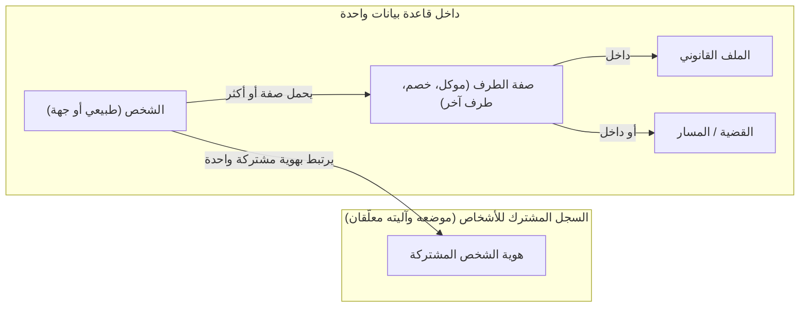
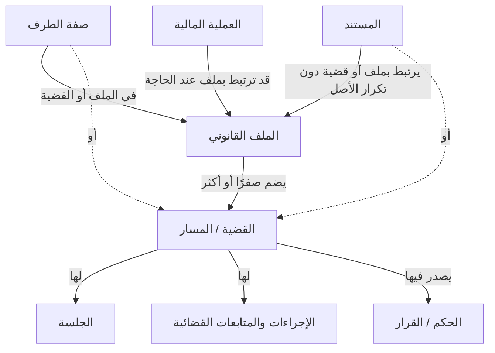
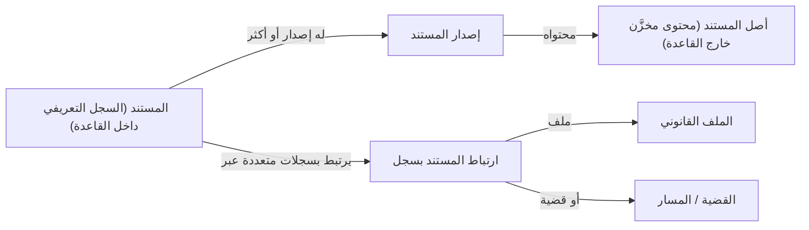
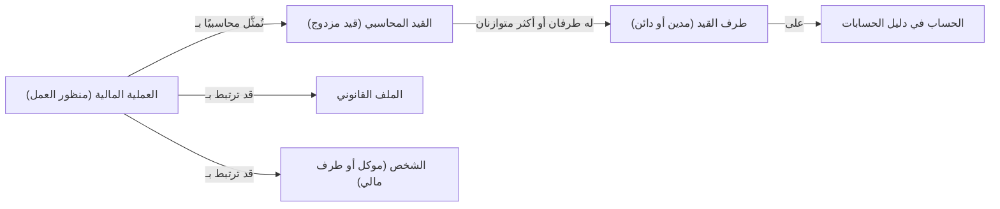
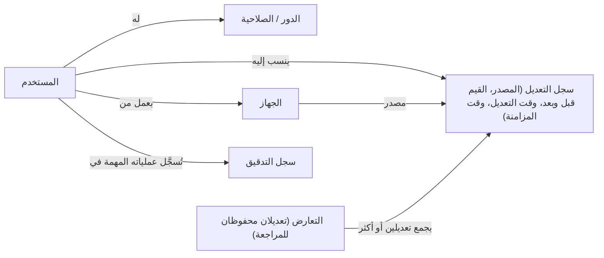
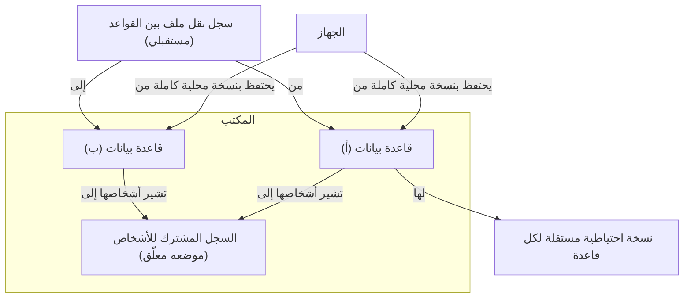
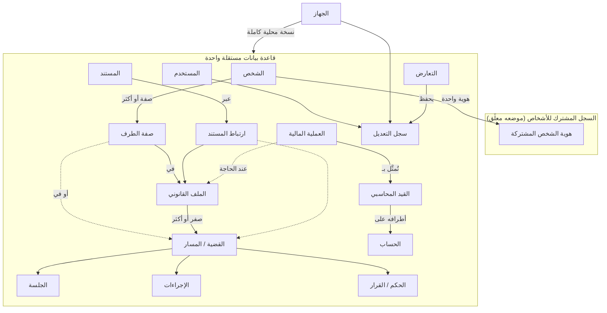

# نموذج البيانات المنطقي الأولي (DOMAIN MODEL)

> **المشروع:** برنامج إدارة مكتب محاماة مصري (المستودع `mizan-law`)
> **المرحلة:** التأسيس التوثيقي — الأمر التنفيذي الأول
> **الحالة:** نموذج مفاهيمي أولي للمراجعة؛ ليس تصميمًا فيزيائيًا ولا مخطط قاعدة بيانات
> **المصدر:** المتطلبات المؤكدة في `REQUIREMENTS.md` (ولا سيما REQ-095 … REQ-101)
> **التاريخ:** 2026-10-18

## 1. المسرد الموحد للمصطلحات

تلتزم جميع وثائق المشروع بهذه المصطلحات.

| المصطلح | التعريف المعتمد في وثائق المشروع |
|---|---|
| **المكتب** | مكتب المحاماة الذي يستخدم البرنامج، بجميع مستخدميه وأجهزته وقواعده. |
| **قاعدة البيانات (القاعدة)** | وحدة تخزين مستقلة تضم ملفاتها وقضاياها وإجراءاتها وبياناتها المالية ومستنداتها (REQ-035). قد يملك المكتب أكثر من قاعدة (REQ-033). |
| **القاعدة النشطة** | القاعدة التي يعمل عليها المستخدم في اللحظة الحالية، وتجري فيها عمليات الإدخال والبحث السريع (REQ-038). |
| **النسخة المحلية** | نسخة كاملة من قاعدة ما محفوظة على جهاز بعينه (REQ-012). |
| **السجل المشترك للأشخاص** | مفهوم يضمن هوية مشتركة للشخص الواحد عبر القواعد دون تكرار غير منضبط (REQ-042). موضعه وآليته معلّقان. |
| **هوية الشخص** | المعرف المفاهيمي الذي يدل على الشخص نفسه عبر القواعد ضمن السجل المشترك. |
| **الشخص** | شخص طبيعي أو جهة (شخص اعتباري أو كيان) تتعامل معه أو تتصل به أعمال المكتب (REQ-095). |
| **الصفة** | الدور الذي يشغله الشخص داخل ملف أو قضية بعينها (موكل، خصم، طرف آخر…) (REQ-096). الشخص الواحد قد يحمل صفات مختلفة في ملفات مختلفة. |
| **الطرف** | شخص له صفة في ملف أو قضية. |
| **الموكل** | الطرف الذي يمثله المكتب أو يعمل لحسابه في ملف ما. ما إذا كان «الموكل» صفةً في ملف فحسب أم حالة مستقلة للشخص مرتبطة بحساب مالي: معلّق (Q-015). |
| **الخصم** | طرف في مواجهة الموكل في ملف أو قضية. |
| **الملف القانوني (الملف الداخلي)** | وحدة تنظيم العمل داخل المكتب؛ قد يضم عدة قضايا أو مسارات، وقد لا يضم أي قضية قضائية (REQ-097، REQ-098). يُستخدم المصطلحان مترادفين. |
| **القضية / المسار** | مسار قضائي أو إجرائي داخل ملف، له درجات تقاضٍ وجلسات وإجراءات وأحكام (REQ-099). يُستخدم «القضية» للمسار القضائي، و«المسار» بمعناه الأعم. |
| **درجة التقاضي** | مرحلة من مراحل المسار القضائي. تمثيلها (جزء من المسار أم كيان مستقل) معلّق (Q-027). |
| **المتابعات** | المصطلح الجامع للجلسات والمواعيد والمهام والأعمال الإدارية والإعلانات والإنذارات والأحكام والقرارات والطعون وإجراءات التنفيذ. ما إذا كان لها كيان جامع واحد معلّق (Q-026). |
| **الإجراء** | فعل قانوني أو إداري موثَّق في سياق ملف أو قضية. |
| **الجلسة** | موعد نظر القضية أمام الجهة القضائية أو ما في حكمها. |
| **الموعد** | التزام زمني ليس جلسة. |
| **المهمة** | عمل محدد يُكلَّف به مستخدم ويُتابَع إنجازه. |
| **الإعلان / الإنذار** | إجراء يُجرى عادة عبر محضر ويرتبط بطرف ما. |
| **الحكم / القرار** | ما يصدر عن الجهة القضائية أو ما في حكمها في قضية. |
| **الطعن** | وسيلة الاعتراض على حكم أو قرار. تمثيله معلّق (Q-027). |
| **إجراء التنفيذ** | إجراء يتعلق بتنفيذ حكم أو سند. |
| **الأعمال القانونية غير القضائية** | أعمال المكتب التي لا تدور في مسار قضائي (نطاقها التفصيلي معلّق Q-038). |
| **المستند** | السجل التعريفي لمحتوى رقمي محفوظ خارج القاعدة ومرتبط بها (REQ-071). |
| **أصل المستند** | المحتوى الرقمي الفعلي للمستند (أو لإصدار منه) المخزَّن في ملف مستقل خارج القاعدة. لا يُكرَّر عند ربط المستند بأكثر من سجل (REQ-072). |
| **إصدار المستند** | حالة محددة من محتوى المستند عبر الزمن (REQ-073). |
| **ارتباط المستند (المرفق)** | العلاقة بين مستند وسجل بعينه (ملف، قضية، أو غيره) (REQ-074). |
| **المرجع القانوني** | مادة مرجعية (نص، سابقة، مرجع) ضمن نطاق المستندات (REQ-061). تمثيله معلّق. |
| **العملية المالية** | حدث مالي من منظور العمل (تحصيل، صرف، استحقاق أتعاب، إيداع أو صرف من أموال موكل…). |
| **القيد المحاسبي** | التمثيل المحاسبي بالقيد المزدوج لعملية مالية، له أطراف مدينة ودائنة متوازنة (REQ-063، REQ-066). |
| **الحساب** | عنصر في دليل الحسابات تُسجَّل عليه أطراف القيود. |
| **أموال الموكلين لدى المكتب** | مبالغ يحتفظ بها المكتب لحساب موكليه، ويجب فصلها عن أموال المكتب (REQ-068). |
| **المستخدم** | شخص يعمل على البرنامج بحساب مستقل (REQ-019). قد يكون المستخدم أيضًا «شخصًا» في النموذج؛ العلاقة بينهما معلّقة. |
| **الدور / الصلاحية** | تجميع للصلاحيات / إذن بتنفيذ عملية أو الوصول إلى بيانات (REQ-029). |
| **الجهاز** | حاسوب أو هاتف يعمل عليه البرنامج ويحتفظ بنسخ محلية ويمكن إبطال وصوله (REQ-012، REQ-023). |
| **المزامنة** | تبادل التعديلات بين النسخ المحلية للقاعدة الواحدة على الأجهزة المختلفة (REQ-008). |
| **التعارض** | تعديلان مختلفان على البيانات نفسها من مصدرين قبل أن يتزامنا؛ يُحفظان معًا للمراجعة (REQ-013). |
| **سجل التعديل** | أثر لتعديل واحد يتضمن المصدر والتوقيت والقيم قبل وبعد حيثما أمكن، مع تمييز وقت التعديل عن وقت مزامنته (REQ-014، REQ-015). |
| **سجل التدقيق (سجل النشاط)** | سجل العمليات المهمة لأغراض التدقيق (REQ-025). |
| **سلة المحذوفات** | الحالة التي يصير إليها السجل المحذوف بحيث يمكن استعادته بدل حذفه نهائيًا (REQ-087، REQ-088). |
| **النسخة الاحتياطية** | نسخة من قاعدة ما (بياناتها وعلاقاتها ومرفقاتها وإعداداتها) تصلح للاستعادة (REQ-085). |
| **نقل الملف بين القواعد** | متطلب مستقبلي لنقل ملف قانوني كامل من قاعدة إلى أخرى مع تتبع مصدره وانتقاله (REQ-047). |

## 2. حدود هذا النموذج

- يصف **المفاهيم والعلاقات المؤكدة فقط**، ولا يختار محرك قاعدة بيانات ولا أنواع بيانات ولا مفاتيح ولا قيودًا نهائية.
- لا يفترض دورة عمل واحدة لكل أنواع الملفات (REQ-101)، ولا يعدّ كل موضوع كيانًا مستقلًا بالضرورة؛ حيثما كان التمثيل غير محسوم يُقال ذلك صراحة.
- كل كيان أو علاقة له **حالة** بأحد الأوسمة: `[معتمد]` (المفهوم والعلاقات المذكورة مؤكدة)، `[معتمد – الآلية معلّقة]` (المفهوم مؤكد وطريقة تمثيله أو آليته معلّقة)، `[يحتاج قرار]` (لم يُحسم وجوده ككيان مستقل أو شكله).
- «الحقول المفاهيمية» هي الحد الأدنى اللازم لفهم الكيان، لا قائمة أعمدة. كل كيان يُفترض أن له **معرفًا** تُحسم آلية توليده لاحقًا (Q-012)، ولن يُكرَّر ذكر ذلك تحت كل كيان.
- مخططات Mermaid في هذه الوثيقة مفاهيمية، وتُظهر العلاقات المؤكدة فقط؛ وما لم يُحسم يُوثَّق نصيًا.

## 3. الأشخاص والهوية

### 3.1 الشخص — `Person`

- **الغرض:** تمثيل كل من تتعامل معه أعمال المكتب: شخص طبيعي أو جهة (REQ-095).
- **العلاقات المؤكدة:**
  - يرتبط بهوية شخص مشتركة واحدة ضمن السجل المشترك (REQ-042).
  - يظهر في ملفات أو قضايا متعددة بصفات مختلفة عبر «صفة الطرف» (REQ-096).
  - قد تكون له علاقة بالمالية (حسابات الموكلين، أموال الموكلين لدى المكتب) (REQ-064) — شكلها معلّق (Q-015).
- **الحقول المفاهيمية:** نوع الشخص (طبيعي / جهة)، الاسم أو الاسم القانوني، بيانات التعريف والتواصل (تفصيلها معلّق)، الإشارة إلى هوية الشخص المشتركة.
- **الحالة:** `[معتمد]` كمفهوم؛ تفصيل حقول الشخص الطبيعي مقابل الجهة `[يحتاج قرار]`.

### 3.2 هوية الشخص المشتركة — `PersonIdentity` (السجل المشترك للأشخاص)

- **الغرض:** ضمان أن الشخص الواحد يُعرف بهوية واحدة عبر القواعد دون تكرار غير منضبط (REQ-042)، مع بقاء بيانات كل قاعدة مستقلة (REQ-040).
- **العلاقات المؤكدة:** هوية واحدة ↔ تمثيل للشخص في قاعدة أو أكثر.
- **الحقول المفاهيمية:** معرف الهوية، البيانات التعريفية الدنيا اللازمة للتعرف (تحديدها معلّق Q-017).
- **ما هو معلّق:** مكان التخزين (مركزي أم موزع) ومزامنته (REQ-043)، السلوك عند نقل قاعدة إلى جهاز آخر (REQ-044)، عرض البيانات التاريخية والحالية (REQ-045)، منع الازدواجية وآلية التعرف (REQ-046).
- **الحالة:** `[معتمد – الآلية معلّقة]`.

### 3.3 صفة الطرف — `Participation`

- **الغرض:** ربط الشخص بملف أو قضية **بصفة محددة** (موكل، خصم، طرف آخر…). هذا الكيان هو ما يسمح بظهور الشخص نفسه بصفات مختلفة في مواضع مختلفة (REQ-096، REQ-100).
- **العلاقات المؤكدة:**
  - شخص واحد ↔ صفات متعددة.
  - الصفة تقع داخل ملف **أو** داخل قضية (الأمر 1 §7: «الصفة داخل الملف أو القضية»).
- **الحقول المفاهيمية:** الشخص، السياق (ملف أو قضية)، الصفة، فترة سريان الصفة إن لزم (معلّق).
- **ما هو معلّق:** قائمة الصفات القانونية النهائية (مدعٍ، مدعى عليه، …) وهل هي بيانات مرجعية لكل قاعدة أم مشتركة (Q-033 مقترح)؛ هل تُشتق صفة الموكل على مستوى الملف من صفاته في قضاياه أم تُسجَّل مستقلة (Q-015).
- **الحالة:** `[معتمد]` كمفهوم؛ تفاصيل الصفات `[يحتاج قرار]`.

### 3.4 الموكل والخصم

ليسا كيانين مستقلين بالضرورة؛ هما **صفتان** يحملهما الشخص في سياق ملف أو قضية. غير أن للموكل بعدًا ماليًا مؤكدًا (حسابات الموكلين، أموال الموكلين لدى المكتب — REQ-064، REQ-068)، وهو ما يطرح سؤال ما إذا كان «الموكل» يحتاج تمثيلًا مستقلًا على مستوى الشخص (Q-015). **الحالة:** `[معتمد – الآلية معلّقة]`.

## 4. الملفات والقضايا

### 4.1 الملف القانوني — `LegalFile`

- **الغرض:** وحدة تنظيم العمل الداخلية في المكتب، وهي المحور الذي تلتف حوله القضايا والمتابعات والمستندات والعمليات المالية.
- **العلاقات المؤكدة:**
  - يرتبط بصفر أو أكثر من القضايا/المسارات (REQ-097، REQ-098).
  - يرتبط بالموكلين والأطراف عبر صفة الطرف (REQ-100).
  - ترتبط به مستندات عبر ارتباط المستند (REQ-072).
  - قد ترتبط به عمليات مالية (REQ-069).
  - عند نقله بين القواعد تُنقل معه عناصره مع تتبع المصدر (REQ-047).
  - يقع داخل قاعدة واحدة بعينها في أي لحظة (REQ-035، REQ-040).
- **الحقول المفاهيمية:** تعريف الملف (رقم أو رمز ظاهر — آلية الترقيم معلّقة Q-035 مقترح)، الموضوع أو الوصف، نوع الملف (قضائي / غير قضائي / مختلط — التصنيف معلّق)، حالة الملف (معلّق Q-034 مقترح)، القاعدة التي ينتمي إليها.
- **ما هو معلّق:** دورة الحياة والحالات (لا تُفرض دورة واحدة — REQ-101)، أنواع الملفات، تمثيل الأعمال غير القضائية (Q-038).
- **الحالة:** `[معتمد]`.

### 4.2 القضية / المسار — `Case`

- **الغرض:** تمثيل مسار قضائي أو إجرائي داخل ملف، بدرجات تقاضيه.
- **العلاقات المؤكدة:**
  - تنتمي إلى ملف واحد (REQ-097).
  - ترتبط بالجلسات والإجراءات والأحكام (REQ-099).
  - لها أطراف بصفاتهم (REQ-096).
  - ترتبط بها مستندات دون تكرار الأصل (REQ-072).
- **الحقول المفاهيمية:** تعريف القضية لدى الجهة القضائية، الجهة، نوع المسار، درجة التقاضي الحالية (تمثيلها معلّق)، حالة المسار (معلّق).
- **ما هو معلّق:** تمثيل درجات التقاضي والطعون: هل الطعن يفتح مسارًا جديدًا أم مرحلة داخل المسار نفسه (Q-027)؛ تسلسل المسارات المرتبطة بعضها ببعض.
- **الحالة:** `[معتمد]` كمفهوم؛ تمثيل الدرجات `[يحتاج قرار]`.

### 4.3 درجة التقاضي — `LitigationStage`

- **الغرض:** التعبير عن مرحلة المسار (ضمن نطاق «القضايا والمسارات ودرجات التقاضي» REQ-061).
- **الحالة:** `[يحتاج قرار]` — المفهوم ضمن النطاق المعتمد، لكن لم يُحسم إن كانت كيانًا مستقلًا أم سمة للمسار أم مسارات متتابعة (Q-027).

## 5. الإجراءات والمتابعات

المفاهيم التالية كلها ضمن النطاق المعتمد (REQ-061). المؤكد علاقيًا هو ارتباط **الجلسات والإجراءات والأحكام بالقضية** (REQ-099). أما ارتباط المواعيد والمهام والأعمال الإدارية بالملف مباشرة أو بالقضية أو باستقلال، وما إذا كان يوجد كيان «إجراء» جامع، فمعلّق (Q-026)، ولذلك لا يُرسم في المخططات. تفاصيل الحقول والحالات والتنبيهات لكل منها تُؤجَّل إلى تصميم الوحدات (Q-039)، وتمثيل التواريخ بالتقويمين مقترح غير معتمد (Q-031).

| الكيان المفاهيمي | الغرض | العلاقات المؤكدة | الحقول المفاهيمية الضرورية | الحالة |
|---|---|---|---|---|
| **الجلسة** `Hearing` | موعد نظر القضية | تنتمي إلى قضية (REQ-099) | التاريخ، الجهة أو الدائرة، ما تم فيها، ما يليها | `[معتمد]` |
| **الموعد** `Appointment` | التزام زمني غير الجلسة | — (الارتباط بالملف/القضية/المستخدم معلّق) | التاريخ والوقت، الموضوع، المعنيون | `[معتمد – الآلية معلّقة]` |
| **المهمة** `Task` | عمل مكلَّف به مستخدم | ترتبط بمستخدم مكلَّف (مستفاد من «المهام» و«المستخدمون») | الوصف، المكلَّف، الاستحقاق، الحالة | `[معتمد – الآلية معلّقة]` |
| **العمل الإداري** `AdminWork` | عمل إداري داخلي | — (تمييزه عن المهمة معلّق) | الوصف، المسؤول، الحالة | `[يحتاج قرار]` |
| **الإعلان / الإنذار** `ServiceNotice` | إجراء يُجرى عادة عبر محضر | يرتبط بطرف؛ يرتبط بقضية أو ملف | النوع، الطرف المعلَن، المحضر، التاريخ، النتيجة | `[معتمد – الآلية معلّقة]` |
| **المحضر** `Bailiff` | الشخص أو الجهة التي تتولى الإعلان | يرتبط بالإعلانات | التعريف وبيانات التواصل | `[يحتاج قرار]` (هل هو «شخص» في النموذج أم بيانات مرجعية) |
| **الحكم / القرار** `Ruling` | ما يصدر في القضية | يصدر في قضية (REQ-099) | التاريخ، المنطوق أو الملخص، الجهة، النوع | `[معتمد]` |
| **الطعن** `Appeal` | الاعتراض على حكم أو قرار | يتعلق بحكم؛ قد يفتح مسارًا (معلّق) | الحكم المطعون فيه، النوع، التاريخ، المآل | `[معتمد – الآلية معلّقة]` (Q-027) |
| **إجراء التنفيذ** `Enforcement` | تنفيذ حكم أو سند | يتعلق بحكم أو سند تنفيذي وبملف | السند، الخطوات، الحالة | `[معتمد – الآلية معلّقة]` |
| **الإجراء الجامع** `Procedure` | كيان عام يجمع المتابعات | — | — | `[يحتاج قرار]` (Q-026) |

## 6. المستندات

### 6.1 المستند — `Document`

- **الغرض:** السجل التعريفي للمحتوى الرقمي، يُدار من داخل القاعدة بينما يُحفظ الأصل خارجها (REQ-071).
- **العلاقات المؤكدة:**
  - له إصدار أو أكثر (REQ-073).
  - يرتبط بعدة سجلات (ملفات، قضايا، وغيرها) عبر ارتباطات دون تكرار الأصل (REQ-072، REQ-074).
  - يُضمَّن في النسخ الاحتياطي والاستعادة والنقل (REQ-075).
  - قد يُصنَّف حساسًا فيخضع لحماية إضافية (REQ-076).
- **الحقول المفاهيمية:** العنوان أو الوصف، النوع أو التصنيف، مؤشر الحساسية (معايير التصنيف معلّقة Q-041)، الإصدار الحالي.
- **الحالة:** `[معتمد]`.

### 6.2 أصل المستند — `DocumentContent`

- **الغرض:** المحتوى الفعلي المخزَّن في ملف مستقل خارج القاعدة ومرتبط بها (REQ-071).
- **العلاقات المؤكدة:** كل إصدار له محتوى؛ المحتوى لا يُكرَّر عند تعدد الارتباطات (REQ-072).
- **الحقول المفاهيمية:** مرجع الموقع (بنية التخزين معلّقة REQ-077)، الحجم، بصمة أو وسيلة للتعرف على المتطابق (الآلية معلّقة REQ-078).
- **الحالة:** `[معتمد – الآلية معلّقة]`.

### 6.3 إصدار المستند — `DocumentVersion`

- **الغرض:** تتبع تغيّر محتوى المستند عبر الزمن (REQ-073).
- **العلاقات المؤكدة:** ينتمي إلى مستند واحد؛ له محتوى.
- **الحقول المفاهيمية:** رقم أو ترتيب الإصدار، تاريخ الإنشاء، المستخدم المنشئ، ملاحظة.
- **ما هو معلّق:** سياسات الإصدارات (REQ-079).
- **الحالة:** `[معتمد – الآلية معلّقة]`.

### 6.4 ارتباط المستند — `DocumentLink`

- **الغرض:** تمثيل علاقة مستند بسجل محدد (REQ-074)، وهو ما يسمح بربط مستند واحد بعدة ملفات أو قضايا (REQ-072).
- **العلاقات المؤكدة:** مستند واحد ↔ سجلات متعددة؛ السجل الواحد ↔ مستندات متعددة.
- **الحقول المفاهيمية:** المستند، السجل المرتبط ونوعه، دور المستند في هذا السياق (اختياري)، تاريخ الربط.
- **ما هو معلّق:** قواعد الملفات المشتركة بين سجلات (REQ-080)، وأثر نقل ملف بين القواعد على مستند مرتبط بسجلات في القاعدة المصدر (R-006 في `OPEN_QUESTIONS.md`).
- **الحالة:** `[معتمد]`.

### 6.5 المرجع القانوني — `LegalReference`

ضمن النطاق (REQ-061). لم يُحسم إن كان نوعًا من المستند أم كيانًا مستقلًا. **الحالة:** `[يحتاج قرار]`.

## 7. المالية (مفاهيم القيد المزدوج)

المبدأ الحاكم: **الفصل بين بيانات العمل القانوني والقيود المحاسبية مع إقامة العلاقات اللازمة بينهما** (REQ-065). لذلك يميز النموذج بين «العملية المالية» (منظور العمل) و«القيد المحاسبي» (المنظور المحاسبي). هذه الوثيقة **لا تضع دليل حسابات ولا جداول محاسبية ولا سياسات** (REQ-070).

### 7.1 الحساب — `Account`

- **الغرض:** عنصر دليل الحسابات الذي تُسجَّل عليه أطراف القيود (REQ-064).
- **العلاقات المؤكدة:** تظهر الحسابات كأطراف في القيود؛ تُستخلص منها دفاتر الأستاذ وميزان المراجعة (REQ-064).
- **الحقول المفاهيمية:** الاسم، الرمز، الطبيعة (مدين/دائن)، التسلسل الهرمي إن وُجد (معلّق).
- **ما هو معلّق:** دليل الحسابات النهائي (Q-021)؛ هل الخزائن والحسابات البنكية وحسابات الموكلين حسابات في الدليل أم كيانات مستقلة مرتبطة بحسابات (Q-021).
- **الحالة:** `[معتمد]` كمفهوم؛ الدليل `[يحتاج قرار]`.

### 7.2 القيد المحاسبي — `JournalEntry` وطرف القيد — `EntryLine`

- **الغرض:** التمثيل المحاسبي المتوازن لعملية مالية وفق القيد المزدوج (REQ-063).
- **العلاقات المؤكدة:**
  - القيد له أطراف (مدينة ودائنة) يجب أن يتوازن مجموعها (REQ-066).
  - كل طرف يشير إلى حساب.
  - القيد يرتبط بالعملية المالية التي يمثلها (REQ-065).
  - يسجَّل مصدر القيد وتعديلاته ضمن تتبع التعديلات (REQ-014، REQ-025).
- **الحقول المفاهيمية للقيد:** التاريخ، البيان، المصدر (العملية المالية)، حالة القيد (معلّق). **لطرف القيد:** الحساب، الجانب (مدين/دائن)، المبلغ.
- **ما هو معلّق:** ترحيل القيود وتعديلها وإلغاؤها (Q-022)، ما يجوز تعديله بالتزامن على أكثر من جهاز (REQ-018)، الفترات المحاسبية (ضمن Q-021).
- **الحالة:** `[معتمد]` كمفهوم؛ دورة حياة القيد `[يحتاج قرار]`.

### 7.3 العملية المالية — `FinancialOperation`

- **الغرض:** الحدث المالي كما يراه العمل: تحصيل من موكل، مصروف، استحقاق أتعاب، إيداع أو صرف من أموال موكل، تحويل بين خزينة وحساب بنكي… (REQ-064).
- **العلاقات المؤكدة:**
  - قد ترتبط بملف قانوني عند الحاجة (REQ-069).
  - قد ترتبط بموكل أو طرف.
  - تُمثَّل محاسبيًا بقيد (REQ-065).
- **الحقول المفاهيمية:** النوع، التاريخ، المبلغ، الطرف المالي (موكل/مورد/غيره)، الملف المرتبط (اختياري)، الوسيلة (خزينة/بنك).
- **ما هو معلّق:** تصنيف أنواع العمليات؛ متى يكون ربطها بملف إلزاميًا (Q-042)؛ العلاقة بين العملية والقيد (واحد لواحد أم غير ذلك — ضمن Q-022).
- **الحالة:** `[معتمد – الآلية معلّقة]`.

### 7.4 الأتعاب والمستحقات، الخزائن والحسابات البنكية، حسابات الموكلين، أموال الموكلين لدى المكتب

كلها ضمن النطاق المعتمد (REQ-064). المؤكد تصميميًا هو **فصل أموال المكتب عن أموال الموكلين** (REQ-068) بحيث لا تختلط أرصدتهما في التقارير والقيود. طريقة تمثيل كل منها (كيانات مستقلة، أم حسابات في الدليل، أم مزيج) **`[يحتاج قرار]`** (Q-021).

### 7.5 المالية في بيئة متعددة القواعد ومتزامنة

- البيانات المالية تنتمي إلى قاعدة واحدة ولا تختلط بين القواعد (REQ-040).
- عند نقل ملف بين القواعد تُراعى القيود المرتبطة به (REQ-047، REQ-048 معلّق).
- خصوصية البيانات المالية عند المزامنة والنقل (REQ-067)، وسياسات تعارض خاصة بالقيود (REQ-017، REQ-018).

## 8. المستخدمون والتدقيق

### 8.1 المستخدم — `User`

- **الغرض:** حساب مستقل لكل من يعمل على البرنامج (REQ-019).
- **العلاقات المؤكدة:** يسجل الدخول ويعمل محليًا (REQ-020)؛ له أدوار/صلاحيات تُطبَّق محليًا (REQ-021)؛ يعمل من جهاز أو أكثر (مستفاد من دعم الكمبيوتر والهاتف معًا — REQ-001، REQ-005)؛ تُنسب إليه التعديلات والعمليات (REQ-014، REQ-025)؛ تُكلَّف إليه المهام.
- **الحقول المفاهيمية:** اسم المستخدم أو المعرف، الاسم الظاهر، الحالة (نشط/موقوف — معلّق)، الأدوار.
- **ما هو معلّق:** المصادقة (REQ-026)، علاقة المستخدم بكيان «الشخص».
- **الحالة:** `[معتمد]`.

### 8.2 الدور والصلاحية — `Role` / `Permission`

- **الغرض:** ضبط ما يجوز لكل مستخدم فعله والوصول إليه، بما في ذلك البيانات المحلية المصرح له بها (REQ-004، REQ-021).
- **ما هو معلّق:** النموذج التفصيلي ومستوياته (قاعدة / ملف / نوع بيانات / عملية) (REQ-029، Q-023)، والتعامل مع الصلاحيات القديمة على الأجهزة غير المتصلة (REQ-030).
- **الحالة:** `[معتمد – الآلية معلّقة]`.

### 8.3 الجهاز — `Device`

- **الغرض:** تمثيل الجهاز الذي يعمل عليه البرنامج، لأغراض النسخ المحلية والمزامنة وإبطال الوصول (REQ-012، REQ-023).
- **العلاقات المؤكدة:** يستخدمه مستخدم أو أكثر؛ يحتفظ بنسخ محلية كاملة من القواعد المختارة (REQ-012)؛ يمكن إبطال وصوله عند عودته للاتصال (REQ-023)؛ هو «مصدر» التعديلات في سجل التعديل (REQ-014).
- **الحقول المفاهيمية:** تعريف الجهاز، النوع (حاسوب/هاتف)، حالة الوصول (فعّال / مُبطَل)، القواعد المتاحة عليه.
- **ما هو معلّق:** آليات الإبطال التقنية (REQ-031).
- **الحالة:** `[معتمد – الآلية معلّقة]`.

### 8.4 سجل التعديل — `ChangeRecord`

- **الغرض:** أثر كل تعديل: مصدره (المستخدم والجهاز) ووقته والقيم قبل وبعد حيثما أمكن (REQ-014)، مع التمييز بين وقت التعديل ووقت مزامنته (REQ-015). هو الأساس المفاهيمي لمراجعة التعارضات.
- **العلاقات المؤكدة:** يشير إلى السجل المعدَّل؛ ينسب إلى مستخدم وجهاز؛ قد يكون طرفًا في تعارض.
- **الحقول المفاهيمية:** السجل المستهدف ونوعه، نوع التعديل (إنشاء/تعديل/حذف إلى السلة/استعادة)، القيم السابقة واللاحقة (حيثما أمكن)، المستخدم، الجهاز، وقت التعديل، وقت المزامنة.
- **ما هو معلّق:** مستوى التسجيل (سجل كامل أم حقل)، الاحتفاظ (Q-013، Q-025).
- **الحالة:** `[معتمد – الآلية معلّقة]`.

### 8.5 التعارض — `Conflict`

- **الغرض:** حفظ التعديلين المتعارضين معًا وإتاحتهما للمراجعة بدل الاستبدال الصامت (REQ-013).
- **العلاقات المؤكدة:** يجمع تعديلين (أو أكثر) على البيانات نفسها من مصادر مختلفة؛ له حالة مراجعة.
- **الحقول المفاهيمية:** السجل محل التعارض، التعديلات المتعارضة، حالة المراجعة، من راجعه ومتى، النتيجة.
- **ما هو معلّق:** آلية الاكتشاف والحل (REQ-016، TD-07)، السياسات بحسب نوع البيانات (REQ-017)، السجلات المالية (REQ-018).
- **الحالة:** `[معتمد – الآلية معلّقة]`.

### 8.6 سجل التدقيق — `AuditLog`

- **الغرض:** تسجيل العمليات المهمة (تسجيل دخول، تغيير صلاحيات، عمليات مالية، نقل ملفات، استعادة من السلة أو من نسخة احتياطية…) لأغراض التدقيق (REQ-025). قائمة العمليات معلّقة (Q-025).
- **العلاقة بسجل التعديل:** مفهومان متكاملان؛ هل يُدمجان في سجل واحد أم يبقيان منفصلين `[يحتاج قرار]`.
- **الحالة:** `[معتمد – الآلية معلّقة]`.

## 9. تعدد القواعد

### 9.1 القاعدة — `Database`

- **الغرض:** وحدة الاستقلال في التخزين والنسخ والنقل (REQ-033، REQ-035، REQ-041).
- **العلاقات المؤكدة:** تحتوي ملفاتها وقضاياها وإجراءاتها وبياناتها المالية ومستنداتها (REQ-035)؛ لها نسخ محلية على أجهزة متعددة (REQ-012)؛ لها نسخ احتياطية مستقلة (REQ-041)؛ تشترك مع غيرها في السجل المشترك للأشخاص (REQ-042)؛ لا تختلط سجلاتها أو بياناتها المالية بغيرها (REQ-040).
- **الحقول المفاهيمية:** الاسم، تعريف فريد عبر الأجهزة (آليته معلّقة Q-012)، تاريخ الإنشاء، الوصف.
- **الحالة:** `[معتمد]`.

### 9.2 القاعدة النشطة

حالة تشغيلية في جلسة المستخدم لا كيان بيانات؛ هي سياق الإدخال والبحث السريع (REQ-036، REQ-038). فتح أكثر من قاعدة معًا `[معتمد – الآلية معلّقة]` (REQ-037).

### 9.3 النسخة المحلية — `LocalCopy`

العلاقة بين جهاز وقاعدة: الجهاز يحتفظ بنسخة كاملة من القواعد التي اختار المستخدم إتاحتها عليه (REQ-012). **الحقول المفاهيمية:** الجهاز، القاعدة، حالة المزامنة الأخيرة. **الحالة:** `[معتمد]` كمفهوم؛ آلية المزامنة معلّقة (TD-06).

### 9.4 هوية السجلات عبر القواعد والأجهزة

يتطلب المزامنةُ (REQ-008) ونقلُ الملفات (REQ-047) أن يبقى معرف السجل مميزًا حين يُنشأ على أجهزة مختلفة دون اتصال وحين ينتقل بين القواعد. هذا **متطلب على المعرفات** لا اختيار لآلية؛ الآلية `[يحتاج قرار]` (REQ-048، Q-012).

### 9.5 سجل نقل الملف — `FileTransferRecord` (مستقبلي)

- **الغرض:** توثيق مصدر الملف المنقول وانتقاله (REQ-047: «معلومات تتبع المصدر والانتقال»).
- **العلاقات المؤكدة:** يشير إلى الملف، والقاعدة المصدر، والقاعدة الهدف، والمستخدم المنفذ، والتاريخ.
- **ما هو معلّق:** نقل أم نسخ، مصير المصدر، العلاقات المشتركة، القيود المحاسبية، التحقق (REQ-048).
- **الحالة:** `[معتمد – الآلية معلّقة]` (متطلب مستقبلي).

### 9.6 النسخة الاحتياطية — `Backup`

- **الغرض:** نسخة قابلة للاستعادة من قاعدة واحدة تشمل البيانات والعلاقات والمرفقات والإعدادات (REQ-085)، مع الاعتماديات المشتركة اللازمة (REQ-086).
- **الحقول المفاهيمية:** القاعدة، وقت الإنشاء، الوجهة، النطاق، نتيجة التحقق من السلامة (REQ-090).
- **الحالة:** `[معتمد – الآلية معلّقة]`.

### 9.7 سلة المحذوفات

حالة للسجلات لا كيان مستقل بالضرورة: السجل المحذوف يبقى قابلًا للاستعادة (REQ-087) ولا يُحذف نهائيًا في العمليات المعتادة (REQ-088) مع الحفاظ على علاقاته (REQ-089). نطاقها وسلوكها مع العلاقات ومتى يجوز الحذف النهائي `[يحتاج قرار]` (Q-029).

### 9.8 البحث داخل القاعدة وعبرها

وظيفة لا كيان: بحث سريع في القاعدة النشطة (REQ-038) وبحث شامل عبر القواعد المتاحة للمستخدم بصورة مستقلة (REQ-039). ما يترتب على ذلك في النموذج (بنى فهرسة، أو فهرس عابر للقواعد) `[يحتاج قرار]` (TD-14).

## 10. المخطط المفاهيمي الجامع (العلاقات المؤكدة فقط)

## 11. ما لم يُحسم (يُوثَّق نصيًا ولا يُرسم)

1. **موضع السجل المشترك للأشخاص** ومزامنته وسلوكه عند نقل قاعدة إلى جهاز آخر (REQ-043، REQ-044).
2. **الموكل** كصفة أم كحالة مستقلة للشخص مرتبطة بحساب مالي (Q-015).
3. **درجات التقاضي والطعون**: مرحلة داخل المسار أم مسار جديد (Q-027).
4. **المتابعات غير القضائية** (المواعيد، المهام، الأعمال الإدارية): ارتباطها بالملف أو القضية أو المستخدم، ووجود كيان جامع (Q-026).
5. **العلاقة بين العملية المالية والقيد** ودورة حياة القيد (ترحيل/تعديل/إلغاء) (Q-022).
6. **تمثيل الخزائن والحسابات البنكية وحسابات الموكلين وأموال الموكلين** (Q-021).
7. **نموذج المستند**: التعرف على المتطابق، سياسات الإصدارات، المستندات المشتركة بعد نقل الملف (Q-020).
8. **آلية معرفات السجلات** عبر الأجهزة والقواعد (Q-012).
9. **مستوى سجل التعديل** (سجل أم حقل) ودمجه مع سجل التدقيق (Q-013، Q-025).
10. **نموذج الأدوار والصلاحيات** ومستوياته (Q-023).
11. **سلة المحذوفات** ونطاقها وسلوكها مع العلاقات (Q-029).
12. **العلاقة بين المستخدم والشخص**.
13. **البيانات المرجعية** (المحاكم، أنواع الدعاوى، الصفات): مشتركة أم لكل قاعدة — مقترح غير معتمد (Q-033).

## 12. مصفوفة الكيانات ← المتطلبات

| الكيان / المفهوم | المتطلبات المؤسِّسة | الحالة |
|---|---|---|
| الشخص | REQ-095، REQ-096 | `[معتمد]` |
| هوية الشخص المشتركة | REQ-042 … REQ-046 | `[معتمد – الآلية معلّقة]` |
| صفة الطرف | REQ-096، REQ-100 | `[معتمد]` |
| الملف القانوني | REQ-097، REQ-098، REQ-100، REQ-101 | `[معتمد]` |
| القضية / المسار | REQ-097، REQ-099 | `[معتمد]` |
| درجة التقاضي | REQ-061 | `[يحتاج قرار]` |
| الجلسة، الحكم/القرار | REQ-099 | `[معتمد]` |
| الموعد، المهمة، الإعلان/الإنذار، الطعن، التنفيذ | REQ-061 | `[معتمد – الآلية معلّقة]` |
| العمل الإداري، المحضر، الإجراء الجامع، المرجع القانوني | REQ-061 | `[يحتاج قرار]` |
| المستند، ارتباط المستند | REQ-071 … REQ-076 | `[معتمد]` |
| أصل المستند، إصدار المستند | REQ-071، REQ-073، REQ-077 … REQ-080 | `[معتمد – الآلية معلّقة]` |
| الحساب، القيد، طرف القيد | REQ-063 … REQ-066 | `[معتمد]` (الدليل ودورة القيد معلّقان) |
| العملية المالية | REQ-064، REQ-065، REQ-069 | `[معتمد – الآلية معلّقة]` |
| فصل أموال المكتب عن أموال الموكلين | REQ-068 | `[معتمد]` |
| المستخدم | REQ-019 … REQ-021 | `[معتمد]` |
| الدور / الصلاحية | REQ-021، REQ-029، REQ-030 | `[معتمد – الآلية معلّقة]` |
| الجهاز، النسخة المحلية | REQ-012، REQ-023 | `[معتمد – الآلية معلّقة]` |
| سجل التعديل، التعارض | REQ-013 … REQ-015 | `[معتمد – الآلية معلّقة]` |
| سجل التدقيق | REQ-025، REQ-032 | `[معتمد – الآلية معلّقة]` |
| القاعدة | REQ-033 … REQ-041 | `[معتمد]` |
| سجل نقل الملف | REQ-047، REQ-048 | `[معتمد – الآلية معلّقة]` (مستقبلي) |
| النسخة الاحتياطية | REQ-083 … REQ-086، REQ-090 | `[معتمد – الآلية معلّقة]` |
| سلة المحذوفات | REQ-087 … REQ-089 | `[معتمد]` (النطاق معلّق) |
