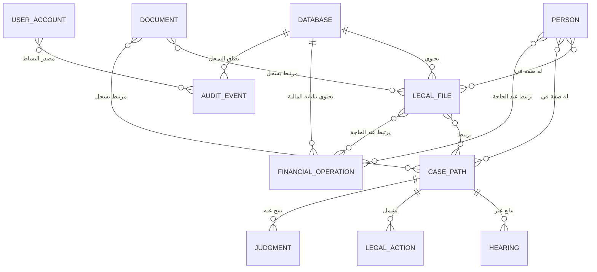

# النموذج المنطقي الأولي

هذا نموذج مفاهيمي لا يحدد جداولًا أو مفاتيح أو أنواع بيانات أو قيودًا نهائية. «معتمد» يصف المفهوم والعلاقة المقررة؛ «معلّق» يعني أن التفاصيل أو الآلية لم تُعتمد.

## مسرد موحد

- **قاعدة بيانات:** نطاق مستقل يحتوي ملفات المكتب وقضاياه وإجراءاته وبياناته المالية ومستنداته.
- **ملف قانوني داخلي (ملف):** تجميع داخلي لموضوع أو أعمال قانونية؛ قد يرتبط بعدة قضايا أو لا يرتبط بقضية.
- **قضية/مسار:** مسار قضائي ودرجاته وإجراءاته المرتبطة، متميز عن الملف الداخلي.
- **شخص:** شخص طبيعي أو جهة؛ قد يكون موكلًا أو طرفًا أو خصمًا أو يؤدي صفات متعددة.
- **هوية شخص مشتركة:** مفهوم يربط تمثيل الشخص نفسه عبر قواعد متعددة؛ مكانه وآلية مطابقته معلّقان.
- **مستند:** أصل وثائقي له بيانات تعريفية وروابط إلى سجل أو أكثر، وقد تكون له إصدارات؛ ملفه محفوظ خارج القاعدة.
- **سجل:** معلومة أو واقعة ضمن مجال البرنامج، دون تقرير أنها كيان تخزيني مستقل.
- **المزامنة:** نقل التغييرات بين نسخ قواعد موزعة على الأجهزة؛ الآلية غير محددة.

## المفاهيم والعلاقات

| المفهوم | الغرض والحقول المفاهيمية الضرورية | العلاقات المؤكدة | الحالة |
|---|---|---|---|
| الشخص الطبيعي والجهة | تمييز نوع الشخص وما يلزم لتعريفه وبيانات تواصله | قد يرتبط بعدة ملفات وقضايا وبصفات مختلفة | معتمد؛ تفاصيل التعريف معلّقة |
| هوية الشخص المشتركة | تمثيل هوية شخص عبر القواعد وتجنب التكرار غير المنضبط | تربط تمثيلات الشخص بين القواعد | المفهوم معتمد؛ الموقع والمطابقة والسلوك معلّق |
| الصفة القانونية | وصف دور الشخص في سياق ملف أو قضية، مثل موكل أو طرف أو خصم | الشخص يرتبط بالسياق بصفة؛ تتعدد الصفات والسياقات | معتمد؛ لا تفرض بنية مستقلة |
| الملف القانوني الداخلي | تنظيم بيانات الملف وأطرافه ومستنداته ومالياته المرتبطة عند الحاجة | قد يرتبط بعدة قضايا، بأشخاص ومستندات، أو يبقى بلا قضية | معتمد |
| القضية/المسار | تنظيم درجات التقاضي والسياق القضائي | تتبع ملفًا؛ ترتبط بأطراف وجلسات وإجراءات وأحكام | معتمد؛ تفاصيل الأنواع والعلاقات الدقيقة معلّقة |
| الجلسة والموعد والمهمة والعمل الإداري | تمثيل المتابعات والأنشطة ذات الصلة | قد ترتبط بملف أو قضية بحسب السياق | المجال معتمد؛ التمييز التفصيلي والحقول معلّق |
| الإعلان والإنذار والمحضر | متابعة الإعلانات والإنذارات وأعمال المحضرين | ترتبط بسياق العمل القانوني | المجال معتمد؛ العلاقات التفصيلية معلّقة |
| الحكم والقرار والطعن والتنفيذ | متابعة المخرجات والطعون وإجراءات التنفيذ | ترتبط بالقضية/المسار حيث ينطبق | المجال معتمد؛ قواعد العمل معلّقة |
| المستند وإصداراته | تعريف الأصل وبياناته وروابطه وإصداراته | مستند واحد يرتبط بسجلات متعددة دون تكرار أصله؛ التخزين خارج القاعدة | المتطلب معتمد؛ بنية التخزين والإصدارات معلّقة |
| الحساب والقيد والعملية المالية | تمثيل مفاهيمي لدليل الحسابات والقيود اليومية والأستاذ والعمليات المالية | ترتبط بموكل أو ملف عند الحاجة؛ بياناتها منفصلة عن بيانات العمل القانوني | النطاق معتمد؛ تصميمها وسياسات ترحيلها وتعديلها معلّقة |
| أموال المكتب وأموال الموكلين | الحفاظ على التمييز بين أموال المكتب وأموال الموكلين لديه | ترتبط بالحسابات والعمليات ذات الصلة | الفصل معتمد؛ قواعد المعالجة معلّقة |
| الحساب المستخدم والدور والصلاحية | تمثيل المستخدمين وامتيازاتهم | صلاحيات محلية وتُراعى تحديثاتها عند المزامنة | معتمد؛ تفاصيل الأدوار والنموذج معلّقة |
| سجل النشاط والتعديل | أثر العمليات المهمة، مصدر التعديل وتوقيته والقيم السابقة واللاحقة حيثما أمكن | يرتبط بالسجل المتأثر والمستخدم والجهاز/المصدر مفاهيميًا | معتمد – الآلية معلّقة؛ الحقول المطلوبة بقدر المتاح |
| المزامنة والتعارض | تمثيل تغييرات الأجهزة والتوقيتين وحفظ نسختي التعديل المتعارض | ترتبط بالسجلات المعدلة وبمصادر التعديل | حفظ التعارضين معتمد؛ نموذج التتبع والحسم معلّق |
| القاعدة النشطة والبحث | سياق القاعدة المستخدمة والبحث داخلها أو عبر القواعد المتاحة | لكل قاعدة استقلال؛ البحث الشامل منفصل عن بحث القاعدة النشطة | معتمد؛ الآلية معلّقة |
| تتبع نقل الملف | مصدر الملف وانتقاله ومحتوياته المرتبطة | يشمل المستندات والأشخاص والماليات والعلاقات بحسب التصور | التصور معتمد؛ النقل/النسخ والمعرفات والقيود معلّقة |

## مخطط العلاقات المفاهيمي

يعرض العلاقات المؤكدة دون تصوير المسائل المعلقة على أنها محسومة.

لا يرسم المخطط الهوية المشتركة أو نقل الملفات أو حسم التعارضات؛ علاقاتها نصية لأن موقعها وآلياتها معلّقة. لا يعني ظهور مفهوم في المخطط وجوب تمثيله كجدول أو كيان تخزيني مستقل.
