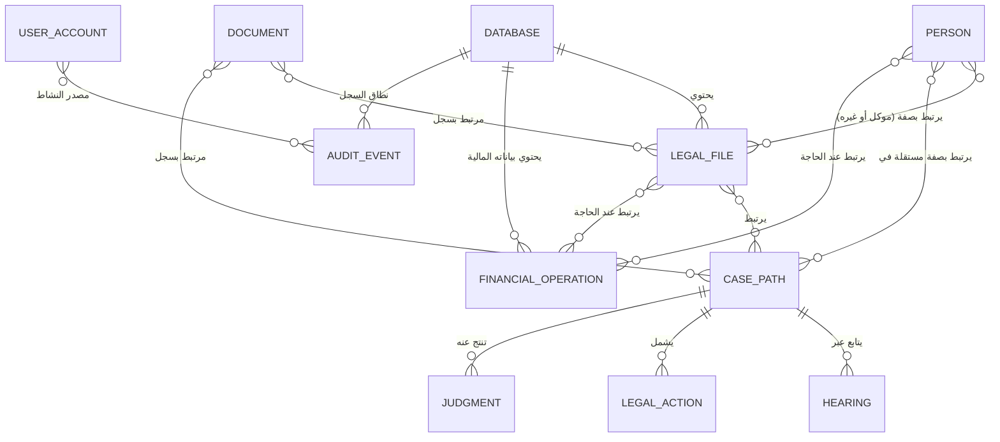

# النموذج المنطقي الأولي

هذا نموذج مفاهيمي لا يحدد جداولًا أو مفاتيح أو أنواع بيانات أو قيودًا نهائية. «معتمد» يصف المفهوم والعلاقة المقررة؛ «معلّق» يعني أن التفاصيل أو الآلية لم تُعتمد.

## مسرد موحد

- **قاعدة بيانات:** نطاق مستقل يحتوي ملفات المكتب وقضاياه وإجراءاته وبياناته المالية ومستنداته.
- **ملف قانوني داخلي (ملف):** تجميع داخلي لموضوع أو أعمال قانونية؛ قد يرتبط بموكل واحد أو أكثر، وبأشخاص بصفات أخرى غير صفة الموكل، وقد يرتبط بعدة قضايا أو لا يرتبط بقضية.
- **قضية/مسار:** مسار قضائي ودرجاته وإجراءاته المرتبطة، متميز عن الملف الداخلي.
- **شخص:** شخص طبيعي أو جهة؛ هويته مستقلة عن صفته داخل الملف أو القضية، وقد يكون موكلًا أو طرفًا أو خصمًا أو يؤدي صفات متعددة تختلف بين الملفات والقضايا.
- **هوية شخص مشتركة:** مفهوم يربط تمثيل الشخص نفسه عبر قواعد متعددة؛ مكانه وآلية مطابقته معلّقان.
- **جلسة:** جلسة محددة أمام محكمة أو جهة مختصة، ترتبط بعمل قانوني أو مسار ذي صلة.
- **موعد:** تاريخ أو وقت مقرر لحدث أو التزام أو متابعة، ولا يُشترط أن يكون جلسة قضائية.
- **مهمة:** عمل مطلوب إنجازه، وقد يرتبط بموعد أو ملف أو قضية أو إجراء.
- **إجراء:** عمل قانوني أو إداري يُتخذ أو تجري متابعته في سياق عمل المكتب.
- **مستند:** أصل وثائقي له بيانات تعريفية وروابط إلى سجل أو أكثر، وقد تكون له إصدارات؛ ملفه محفوظ خارج القاعدة.
- **سجل:** معلومة أو واقعة ضمن مجال البرنامج، دون تقرير أنها كيان تخزيني مستقل.
- **المزامنة:** نقل التغييرات بين نسخ قواعد موزعة على الأجهزة؛ الآلية غير محددة.

## القواعد المفاهيمية المعتمدة لعلاقة الملف بالموكلين والأشخاص

تُعتمد القواعد المفاهيمية التالية في توصيف علاقة الملف القانوني بالأشخاص والموكلين:

1. يمكن أن يرتبط الملف القانوني الواحد بأكثر من موكل.
2. يمكن أن يرتبط الموكل الواحد بأكثر من ملف قانوني.
3. قد يرتبط الشخص بالملف بصفة غير صفة الموكل (مثل خصم أو طرف ذي صلة أو غير ذلك).
4. هوية الشخص مستقلة عن صفته داخل الملف أو القضية.
5. يمكن أن تختلف صفة الشخص بين الملفات والقضايا.

تُقرّر هذه القواعد على المستوى المفاهيمي فقط؛ ولا تعتمد هذه الوثيقة آلية تقنية لتمثيل العلاقات، ولا تنشئ مفاتيح أو جداول تخزينية.

## التمييز المفاهيمي المعتمد بين مفاهيم المتابعة

تُعتمد التعريفات والفروق المفاهيمية التالية بين مفاهيم المتابعة:

- **الجلسة:** جلسة محددة أمام محكمة أو جهة مختصة، ترتبط بعمل قانوني أو مسار ذي صلة.
- **الموعد:** تاريخ أو وقت مقرر لحدث أو التزام أو متابعة، ولا يُشترط أن يكون جلسة قضائية.
- **المهمة:** عمل مطلوب إنجازه، وقد يرتبط بموعد أو ملف أو قضية أو إجراء.
- **الإجراء:** عمل قانوني أو إداري يُتخذ أو تجري متابعته في سياق عمل المكتب.

ويُراعى في هذا التمييز المعتمد ما يلي:

1. هذه المفاهيم متميزة وظيفيًا.
2. قد توجد علاقات بينها بحسب سياق العمل.
3. لا يُشترط ارتباط كل مهمة بقضية.
4. لا يُشترط أن يكون كل موعد جلسة.
5. لا يُفترض أن كل إجراء مهمة.
6. لا يترتب على هذا التمييز اعتماد كيانات أو جداول مستقلة لمجرد هذا التمييز، ولا تُضاف بموجبه دورات عمل أو حالات تفصيلية لم تُعتمد.

## المفاهيم والعلاقات

| المفهوم | الغرض والحقول المفاهيمية الضرورية | العلاقات المؤكدة | الحالة |
|---|---|---|---|
| الشخص الطبيعي والجهة | تمييز نوع الشخص وما يلزم لتعريفه وبيانات تواصله، مع استقلال هويته عن صفته | يرتبط الموكل الواحد بملف قانوني أو أكثر، وقد يرتبط الشخص بعدة ملفات وقضايا بصفات مختلفة (موكل أو غير موكل) | معتمد؛ تفاصيل التعريف معلّقة |
| هوية الشخص المشتركة | تمثيل هوية شخص عبر القواعد وتجنب التكرار غير المنضبط | تربط تمثيلات الشخص بين القواعد | المفهوم معتمد؛ الموقع والمطابقة والسلوك معلّق |
| الصفة القانونية | وصف دور الشخص في سياق ملف أو قضية، مثل موكل أو طرف أو خصم، بصورة مستقلة عن هويته | يرتبط الشخص بالملف أو القضية بصفة؛ يمكن أن تختلف صفة الشخص بين الملفات والقضايا | معتمد؛ لا تفرض بنية مستقلة |
| الملف القانوني الداخلي | تنظيم بيانات الملف وأطرافه ومستنداته ومالياته المرتبطة عند الحاجة | يمكن أن يرتبط بأكثر من موكل، وبأشخاص بصفة غير الموكل، وبعدة قضايا أو إجراءات أو مهام أو مواعيد أو مستندات، أو يبقى بلا قضية | معتمد |
| القضية/المسار | تنظيم درجات التقاضي والسياق القضائي | تتبع ملفًا؛ ترتبط بأشخاص ذوي صفات مستقلة في سياقها وبجلسات وإجراءات وأحكام | معتمد؛ تفاصيل الأنواع والعلاقات الدقيقة معلّقة |
| الجلسة | جلسة محددة أمام محكمة أو جهة مختصة | ترتبط بعمل قانوني أو مسار ذي صلة، وقد ترتبط بموعد أو مهمة أو إجراء | المفهوم والتمييز الوظيفي معتمد؛ الحقول التفصيلية والتمثيل معلّقان دون فرض كيان مستقل |
| الموعد | تاريخ أو وقت مقرر لحدث أو التزام أو متابعة | لا يُشترط أن يكون جلسة قضائية؛ قد يرتبط بملف أو قضية أو مهمة أو إجراء | المفهوم والتمييز الوظيفي معتمد؛ الحقول التفصيلية والتمثيل معلّقان دون فرض كيان مستقل |
| المهمة | عمل مطلوب إنجازه داخل المكتب | قد ترتبط بموعد أو ملف أو قضية أو إجراء، ولا يُشترط ارتباط كل مهمة بقضية | المفهوم والتمييز الوظيفي معتمد؛ الحقول التفصيلية والتمثيل معلّقان دون فرض كيان مستقل |
| الإجراء | عمل قانوني أو إداري يُتخذ أو تجري متابعته في سياق عمل المكتب | قد يرتبط بملف أو قضية أو مهمة أو موعد، ولا يُفترض أن كل إجراء مهمة | المفهوم والتمييز الوظيفي معتمد؛ الحقول التفصيلية والتمثيل معلّقان دون فرض كيان مستقل |
| الإعلان والإنذار والمحضر | متابعة الإعلانات والإنذارات وأعمال المحضرين | ترتبط بسياق العمل القانوني | المجال معتمد؛ العلاقات التفصيلية معلّقة |
| الحكم والقرار والطعن والتنفيذ | متابعة المخرجات والطعون وإجراءات التنفيذ | ترتبط بالقضية/المسار حيث ينطبق | المجال معتمد؛ قواعد العمل معلّقة |
| المستند وإصداراته | تعريف الأصل وبياناته وروابطه وإصداراته | مستند واحد يرتبط بسجلات متعددة دون تكرار أصله؛ التخزين خارج القاعدة | المتطلب معتمد؛ بنية التخزين والإصدارات معلّقة |
| الحساب والقيد والعملية المالية | تمثيل مفاهيمي لدليل الحسابات والقيود اليومية والأستاذ والعمليات المالية | ترتبط بموكل أو ملف عند الحاجة؛ بياناتها منفصلة عن بيانات العمل القانوني | النطاق معتمد؛ تصميمها وسياسات ترحيلها وتعديلها معلّقة |
| أموال المكتب وأموال الموكلين | الحفاظ على التمييز بين أموال المكتب وأموال الموكلين لديه | ترتبط بالحسابات والعمليات ذات الصلة | الفصل معتمد؛ قواعد المعالجة معلّقة |
| الحساب المستخدم والدور والصلاحية | تمثيل المستخدمين وامتيازاتهم | صلاحيات محلية وتُراعى تحديثاتها عند المزامنة | معتمد؛ تفاصيل الأدوار والنموذج معلّقة |
| سجل النشاط والتعديل | أثر العمليات المهمة، مصدر التعديل وتوقيته والقيم السابقة واللاحقة حيثما أمكن | يرتبط بالسجل المتأثر والمستخدم والجهاز/المصدر مفاهيميًا | معتمد – الآلية معلّقة؛ الحقول المطلوبة بقدر المتاح |
| المزامنة والتعارض | تمثيل تغييرات الأجهزة والتوقيتين وحفظ نسختي التعديل المتعارض | ترتبط بالسجلات المعدلة وبمصادر التعديل | حفظ التعارضين معتمد؛ نموذج التتبع والحسم معلّق |
| القاعدة النشطة والبحث | سياق القاعدة المستخدمة والبحث داخلها أو عبر القواعد المتاحة | لكل قاعدة استقلال؛ البحث الشامل منفصل عن بحث القاعدة النشطة | معتمد؛ الآلية معلّقة |
| تتبع نقل الملف | مصدر الملف وانتقاله ومحتوياته المرتبطة | يشمل المستندات والأشخاص والماليات والعلاقات بحسب التصور | التصور معتمد؛ النقل/النسخ والمعرفات والقيود معلّقة |

## مخطط العلاقات المفاهيمي

يعرض العلاقات المؤكدة دون تصوير المسائل المعلقة على أنها محسومة.

توضح علاقتا `PERSON }o--o{ LEGAL_FILE` و`PERSON }o--o{ CASE_PATH` إمكان ارتباط الملف القانوني الواحد بأكثر من موكل وارتباط الموكل الواحد بأكثر من ملف قانوني، وإمكان ارتباط الشخص بالملف بصفة غير صفة الموكل، مع استقلال هوية الشخص عن صفته التي قد تختلف بين الملفات والقضايا. كما تظل مفاهيم المتابعة (الجلسة، الموعد، المهمة، الإجراء) متميزة وظيفيًا وقابلة للارتباط بالملف أو القضية أو ببعضها وفق القواعد النصية المعتمدة أعلاه. لا يرسم المخطط الهوية المشتركة أو نقل الملفات أو حسم التعارضات؛ علاقاتها نصية لأن موقعها وآلياتها معلّقة. لا يعني ظهور مفهوم في المخطط أو عدم إفراده فيه وجوب تمثيله كجدول أو كيان تخزيني مستقل.
