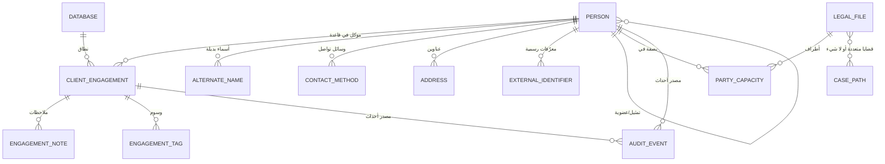

# نموذج البيانات المنطقي — وحدة الموكلين

| الحقل | القيمة |
|---|---|
| المرحلة | تصميم وتحليل فقط — **لا مخطط SQL، ولا جداول، ولا مفاتيح** |
| الحالة | **مقترح — بانتظار الاعتماد** |
| التاريخ | 2026-10-18 |
| الوثيقة الأم | `CLIENTS_MODULE_VISION.md`، `docs/DOMAIN_MODEL.md` (النموذج المنطقي الأولي) |
| تحذير | الكيانات هنا **مفاهيم** تُسمّى للحديث فقط. تحويلها إلى جداول ومسارات تخزين قرار تقني مؤجل |

---

## 1. المبدأ الحاكم للنموذج

> **لا يوجد «كيان موكل».** يوجد **شخص** (هوية مشتركة) + **علاقة موكل** (في قاعدة) + **صفة** (في ملف أو قضية).

هذه ليست تسمية أنيقة، بل نتيجة مباشرة لثلاثة قرارات معتمدة:

| القرار | الأثر البنيوي |
|---|---|
| ADQ-03 + A-22: هوية الشخص موحدة داخل تثبيت المكتب | معرّف الشخص **لا** يكون محليًا لقاعدة |
| ADQ-10 + A-27: سجل الأشخاص المشترك لا يحمل بيانات الملفات أو الماليات | محتوى السجل المشترك **محدود** |
| `docs/DOMAIN_MODEL.md` القواعد 1–5: الملف قد يكون لموكل واحد أو أكثر، والموكل لملف واحد أو أكثر، والشخص بصفة تختلف بين الملفات | العلاقة **متعدد إلى متعدد** مع صف |

## 2. الطبقات الثلاث

```
┌──────────────────────────────────────────────────────────────┐
│  الطبقة الأولى — الهوية المشتركة (نطاق التثبيت)             │
│  سجل الأشخاص المشترك · مرجع تحت سيطرة المكتب · نسخ محلية    │
│  ┌────────────┐  ┌──────────────┐  ┌────────────┐           │
│  │  شخص       │──│ اسم بديل     │  │ معرّف خارجي │           │
│  └─────┬──────┘  └──────────────┘  └────────────┘           │
│        │  ┌──────────────┐  ┌────────────┐  ┌────────────┐ │
│        ├──│ وسيلة تواصل  │──│ عنوان      │──│ علاقة تمثيل │ │
│        │  └──────────────┘  └────────────┘  └────────────┘ │
└────────┼─────────────────────────────────────────────────────┘
         │  (لا تُنقل ملفات ولا مالية ولا ملاحظات القاعدة عبر هذا الحد)
         ▼
┌──────────────────────────────────────────────────────────────┐
│  الطبقة الثانية — علاقة الموكل (نطاق القاعدة)               │
│  ┌──────────────────────┐  ┌──────────────┐                │
│  │ علاقة موكل (شخص↔قاعدة)│─▶│ ملاحظة        │                │
│  └──────────┬───────────┘  └──────────────┘                │
│             │  ┌──────────────┐  ┌────────────┐              │
│             ├──│ تصنيف/وسم   │──│ حقول مخصصة │              │
│             │  └──────────────┘  └────────────┘              │
└─────────────┼───────────────────────────────────────────────┘
              ▼
┌──────────────────────────────────────────────────────────────┐
│  الطبقة الثالثة — الصفة (نطاق الملف/القضية) — مالكها غير هذه الوحدة │
│  شخص ⟶ ملف (موكل/خصم/طرف/…) · شخص ⟶ قضية (صفة مستقلة)      │
└──────────────────────────────────────────────────────────────┘
```

## 3. الكيانات المقترحة

> التسميات إنجليزية **مقابض توثيقية** فقط. لا تعني جداول ولا مفاتيح ولا حقولًا فعلية.

### 3.1 الطبقة الأولى — الهوية المشتركة

| الكيان | الغرض | محتواه المنطقي | ملاحظات |
|---|---|---|---|
| **Person** | تمثيل الشخص | الاسم الرئيسي، الاسم الرسمي، الاسم بالإنجليزية، النوع (طبيعي/جهة)، معرّف ثابت، تواريخ، حالة السجل | معرّفه **ثابت عبر التثبيت** (ADQ-07) |
| **AlternateName** | أسماء أخرى | النص، نوعه (لقب، اسم بالحرف اللاتيني، اسم تجاري، خطأ شائع) | تُبحث (ADQ-42) |
| **ExternalIdentifier** | معرّفات رسمية | النوع (قومي/تجاري/ضريبي/جواز)، القيمة، حالة التحقق، ملاحظة مشروعية الحفظ | ADQ-11: «يجوز الاستفادة من معرّفات رسمية خارجية عند توافرها والتحقق منها ومشروعية حفظها» |
| **ContactMethod** | وسيلة تواصل | النوع (جوال/هاتف ثابت/بريد/تطبيق/أخرى)، القيمة، الصورة المطبَّعة للبحث، الأولوية، مرئية | ADQ-42: الأصل محفوظ والمطبَّع للبحث فقط |
| **Address** | عنوان | النوع (سكن/عمل/مراسلة)، البنية الهرمية (دولة→محافظة→مدينة→شارع→رقم)، المرجع على الخريطة | — |
| **OrganizationMembership** | علاقة الشخص بجهة | الشخص، الجهة، نوع العلاقة (ممثل/مالك/مسؤول/موظف) | **نطاقها معلّق** — `CD-04` |
| **PersonMerge** | سجل دمج | الشخص المحتفظ به، الشخص المدمج، المعاملات المدمجة، المستخدم، الوقت، قابل للتراجع المنضبط | ADQ-13 |

**لماذا لا يوجد حقل «رقم العميل» هنا؟** لأن الرقم الداخلي للموكل يتبع **القاعدة**؛ فوضعه في السجل المشترك يعني أن رقمًا خاصًا بقاعدة يظهر في كل القواعد. انظر `CD-07`.

### 3.2 الطبقة الثانية — علاقة الموكل (نطاق القاعدة)

| الكيان | الغرض | محتواه المنطقي | ملاحظات |
|---|---|---|---|
| **ClientEngagement** | ربط الشخص بالقاعدة بصفته موكلًا | الشخص، القاعدة، الحالة (نشط/مؤرشف/محذوف منطقيًا)، التصنيف، تاريخ البدء، وسيلة التواصل المفضلة، ملاحظات التفضيل، الأرقام الداخلية، تواريخ | **هذا هو ما يسمّيه المستخدم «سجل الموكل»** |
| **EngagementNote** | ملاحظة على العلاقة | النص، النطاق (خاص/مشترك)، المؤلف، التاريخ، الإصدارات | ADQ-32: لا استبدال صامت |
| **EngagementTag** | تصنيف حر | الوسم، مصدره (يدوي/نظام) | نطاقها: القاعدة |
| **EngagementCustomValue** | قيم الحقول المخصصة | الحقل المعرّف، القيمة | ADQ-44: حقول منضبطة بحسب نوع السجل |
| **EngagementStatusHistory** | تاريخ تغيير الحالة | الحالة السابقة، الجديدة، المستخدم، الوقت، السبب | يخدم ADQ-40 وADQ-31 وADQ-32 |

**لماذا علاقة مستقلة عن الشخص؟** لأن:
1. الشخص قد يكون موكلًا في قاعدة وغير موكل في أخرى (ADQ-03، A-27).
2. حالة الموكل (مؤرشف) تخص العلاقة، لا الهوية؛ أرشفة الموكل لا تمس هوية الشخص (ADQ-40).
3. الملاحظات والتصنيفات القانونية تخص العلاقة وتبقى داخل القاعدة (ADQ-27).

### 3.3 الطبقة الثالثة — الصفة (خارج ملكية هذه الوحدة)

| الكيان | الغرض | المالك | ملاحظات |
|---|---|---|---|
| **PartyCapacity** | صفة الشخص في ملف أو قضية | وحدة الملفات والقضايا | `DOMAIN_MODEL` القواعد 3–5؛ قد تختلف بين ملف وآخر |
| **LegalFile** | الملف القانوني الداخلي | وحدة الملفات | قد يرتبط بعدة قضايا أو بلا قضية |
| **CasePath** | القضية/المسار | وحدة القضايا | قد تتبع ملفًا واحدًا أو أكثر |

> **الحد**: هذه الوحدة **تقرأ** `PartyCapacity` لعرض الصفة، ولا تكتبها ولا تكررها.

### 3.4 كيانات عامة يستهلكها القسم

| الكيان | المالك | الاستهلاك في هذه الوحدة |
|---|---|---|
| Database | وحدة القواعد | اسم القاعدة، القاعدة النشطة، معرّف القاعدة |
| UserAccount | نظام المستخدمين | صاحب التعديل، الصلاحيات |
| AuditEvent | سجل التدقيق | عرض سجل النشاط (قراءة فقط) |
| Document | وحدة المستندات | روابط المستندات المرجعية |
| FinancialAccount | وحدة المحاسبة | إجمالي الموكل داخل القاعدة (ADQ-33) |
| CustomFieldDefinition | نظام الحقول المخصصة | تعريفات الحقول (ADQ-44) |
| SearchIndex | منظومة البحث | تنفيذ البحث والتطبيع (ADQ-42) |

## 4. العلاقات والتعدّديات

| # | العلاقة | التعدّد | ملاحظات |
|---|---|---|---|
| R1 | Person ⟶ ClientEngagement | واحد إلى متعدد | شخص واحد موكل في عدة قواعد |
| R2 | ClientEngagement ⟶ Database | متعدد إلى واحد | علاقة لا تنسخ بيانات القاعدة |
| R3 | Person ⟶ AlternateName | واحد إلى متعدد | — |
| R4 | Person ⟶ ContactMethod | واحد إلى متعدد | — |
| R5 | Person ⟶ Address | واحد إلى متعدد | — |
| R6 | Person ⟶ ExternalIdentifier | واحد إلى متعدد | أنواع مختلفة |
| R7 | Person ⟶ Person (عبر OrganizationMembership) | متعدد إلى متعدد | علاقة تمثيل غير متماثلة |
| R8 | ClientEngagement ⟶ EngagementNote | واحد إلى متعدد | — |
| R9 | Person ⟶ PartyCapacity ⟶ LegalFile | متعدد إلى متعدد | مع صف (قاعدة 1–2) |
| R10 | LegalFile ⟶ CasePath | متعدد إلى متعدد | أو بلا علاقة (قرار معتمد) |
| R11 | Person ⟶ Document | متعدد إلى متعدد | المستند قد يرتبط بسجلات متعددة (ADQ-30) |
| R12 | Person/Engagement ⟶ AuditEvent | واحد إلى متعدد | إلحاقي (ADQ-32) |

### 4.1 مخطط العلاقات المنطقي



> المخطط **مفاهيمي**، ومأخوذ على أساس `docs/DOMAIN_MODEL.md` مع استكمال ما طلبه أمر المرحلة. لا يحدد أي جدول ولا مفتاحًا ولا نوع بيانات.

## 5. الثوابت (قواعد لا يجوز كسرها)

| # | الثابت | التطبيق | السند |
|---|---|---|---|
| I1 | معرّف الشخص ثابت عبر كل قواعد التثبيت | لا يُولَّد معرّف شخص جديد عند النقل (ADQ-22) | ADQ-03، ADQ-07 |
| I2 | الاسم وحده لا يثبت وحدة الشخص | لا منع ولا دمج تلقائي | ADQ-11، ADQ-12 |
| I3 | لا تكرار تلقائي | المنع فقط عند تطابق موثوق ومؤكد | ADQ-12 |
| I4 | الدمج إجراء صريح بصلاحية ومراجعة، ويحفظ المعرفات السابقة والإحالات والتاريخ، وله مسار تراجع منضبط | | ADQ-13 |
| I5 | الملف قد يكون لموكلين متعددين، والموكل لملفات متعددة | | `DOMAIN_MODEL` 1–2 |
| I6 | الشخص قد يختلف صفته بين الملفات والقضايا | الصفة على العلاقة لا على الشخص | `DOMAIN_MODEL` 3–5 |
| I7 | الملف الداخلي متميز عن القضية | | قرار معتمد |
| I8 | الاشتراك في الهوية لا ينقل ملفات أو مالية بين القواعد | | ADQ-10، A-27 |
| I9 | الأرشفة حالة قابلة للعكس، ولا تمس الملفات | | ADQ-40 |
| I10 | الحذف المعتاد إلى سلة قابلة للاستعادة؛ الحذف النهائي استثنائي ومقيّد | | ADQ-31 |
| I11 | الحقول المشتركة تُحفظ بقيمها الأصلية، والبحث يتم على صورة مطبَّعة | | ADQ-42 |
| I12 | كل عملية تُحفظ كوحدة متكاملة، وإعادة المحاولة لا تكرر الأثر | | ADQ-19 |
| I13 | التعديلات المتعارضة لا يُمحى أحدها ولا يُستبدل صامتًا | | ADQ-16، A-26 |
| I14 | الصلاحيات قيد على البيانات لا على الواجهة | | ADQ-25 |
| I15 | سجل النشاط إلحاقي وغير قابل للتحرير العادي | | ADQ-32 |
| I16 | كل حقل يملك **نطاقًا** معلنًا: تثبيت أو قاعدة | | هذا النموذج |
| I17 | إضافة علاقة موكل = عملية واحدة ذرّية (إنشاء + ربط) | | ADQ-19 |
| I18 | لا يُحذف سجل النشاط | | ADQ-32 |

## 6. ملكية البيانات: أي طبقة تملك كل حقل

هذا هو الجدول المرجعي الأهم في هذه الوثيقة، لأن منه تُشتق حدود المزامنة وحماية السرية.

| مجموعة الحقول | النطاق | تُزامَن بين القواعد؟ | تُشارَك بين الأجهزة؟ | ملاحظات |
|---|---|---|---|---|
| الاسم الرئيسي/الرسمي/البديل/الإنجليزي | تثبيت | **نعم** | نعم | ADQ-14 |
| المعرّفات الرسمية | تثبيت | **نعم** | نعم | مشروعية الحفظ تحتاج مراجعة (`CD-06`) |
| وسائل التواصل | تثبيت | **نعم** | نعم | مع الأصل والصورة المطبَّعة |
| العناوين | تثبيت | **نعم** | نعم | — |
| علاقة التمثيل | تثبيت (مقترح) | نعم (معلّق) | نعم | `CD-04` |
| حالة السجل (هوية) | تثبيت | — | — | الإلغاء/الاستعادة |
| **علاقة الموكل (وجوده في القاعدة)** | قاعدة | **لا** | نعم (ضمن نسخ القاعدة) | ADQ-10، A-27 |
| تصنيف الموكل ووسومه | قاعدة | **لا** | نعم | — |
| تاريخ بدء العلاقة | قاعدة | **لا** | نعم | — |
| وسيلة التواصل المفضلة | قاعدة | **لا** | نعم | سلوك المكتب |
| الأرقام الداخلية | قاعدة | **لا** | نعم | `CD-07` |
| الملاحظات | قاعدة (افتراضي) | **لا** | نعم | `CD-03` |
| الحقول المخصصة | قاعدة | **لا** | نعم | ADQ-44 |
| حالة العلاقة (نشط/مؤرشف/محذوف) | قاعدة | **لا** | نعم | ADQ-31، ADQ-40 |
| الصفة داخل الملف/القضية | ملف/قضية | **لا** | نعم (ضمن القاعدة) | مالكها وحدة الملفات |
| الحساب المالي | قاعدة | **لا** | نعم | ADQ-33 |
| سجل النشاط | نظام | — | نعم (ملحاق) | ADQ-32 |

### 6.1 القاعدة المستخلصة

> **لا يُشترَط أن يُزامَن الحقل عبر القواعد لمجرد أنه «بيانات موكل».** المعيار هو **ملكية المكتب للعلاقة**: ما يخص علاقة المكتب بالشخص داخل قاعدة بعينها يبقى فيها.

## 7. دلالات المزامنة والتعارض

### 7.1 قواعد مستخلصة من ADQ-15 وADQ-16

| # | القاعدة | التطبيق في هذه الوحدة |
|---|---|---|
| S1 | التسلسل المنطقي + توقيت مرجعي موحد | كل سجل يحمل ترتيبًا منطقيًا وتوقيتًا مرجعيًا وتوقيت تعديل وتوقيت مزامنة منفصلين |
| S2 | تعديلان متعارضان على الشخص: حفظ ومراجعة بشرية | شاشة التعارض (S-05) تعرض القيمتين بمصدرهما ووقتيهما |
| S3 | **مستوى التعارض: الحقل** (مقترح) | عرض الحقل المتعارض فقط لا السجل كاملًا (انظر `CD-09`) |
| S4 | لا محو صامت | التعديل غير المعتمد يبقى في السجل التاريخي |
| S5 | الدمج كامل أو لا شيء | ADQ-19 |
| S6 | العمل دون اتصال مستمر | كل عملية الإضافة/التعديل تعمل محليًا أولًا |
| S7 | عند الانقطاع الطويل: تنبيه تباعد | في مركز الموكلين |
| S8 | العمليات التي تحتاج اعتمادًا مشتركًا تبقى معلّقة | مثال: الحذف النهائي |

### 7.2 ماذا يُزامَن وماذا لا يُزامَن

| العملية | ما ينتقل | ملاحظة |
|---|---|---|
| إنشاء موكل جديد | السجل في السجل المشترك + علاقة الموكل في القاعدة | عمليتان في معاملة واحدة منطقيًا (I17) |
| تعديل اسم | نسخة الهوية فقط | لا يمس علاقة الموكل |
| تعديل تفضيل التواصل | علاقة الموكل فقط | لا يمس السجل المشترك |
| أرشفة | علاقة الموكل فقط | لا يمس الهوية ولا الملفات |
| نقل ملف بين قواعد | **لا ينقل** علاقة الموكل ولا الهوية (ADQ-22: «لا تُنشأ هوية شخص جديدة») | يبقى الشخص في السجل المشترك |
| دمج شخصين | سجل دمج + تحديث الإحالات | ADQ-13 |

## 8. دورة حياة السجل

### 8.1 حالة علاقة الموكل

```
        إنشاء
          │
          ▼
      ┌────────┐  أرشفة   ┌──────────┐  استعادة  ┌────────┐
      │ نشط    │──────────▶│ مؤرشف    │──────────▶│ نشط    │
      └────┬───┘           └────┬─────┘           └────────┘
           │ نقل إلى السلة       │
           ▼                     │
      ┌──────────┐               │
      │ محذوف    │◀──────────────┘ (نقل إلى السلة من المؤرشف: مسموح؟)
      │ منطقيًا  │   استعادة
      └────┬─────┘──────────────▶ نشط
           │
           ▼
   ┌──────────────┐
   │ حذف نهائي    │ استثنائي، مقيّد، موثّق (ADQ-31)
   └──────────────┘
```

| # | قاعدة | السند |
|---|---|---|
| L1 | الأرشفة **لا** تمس الملفات ولا القضايا | ADQ-40 + قرار «الملف قد لا يرتبط بقضية» |
| L2 | استعادة السلة تعيد الحالة السابقة بكل علاقاتها | ADQ-29، ADQ-31 |
| L3 | الحذف النهائي **لا** يُطبق على سجل مرتبط بملفات أو قيود محاسبية | ADQ-31، ADQ-34 |
| L4 | لا يُحذف أي سجل نشاط | ADQ-32 |
| L5 | تغيير الحالة يُسجَّل في سجل النشاط وفي تاريخ الحالة | ADQ-32 |
| L6 | السجلات المؤرشفة تبقى قابلة للبحث والتدقيق | ADQ-40 |
| L7 | الأرشفة على مستوى **العلاقة**، لا الهوية | نموذج هذا الفصل |

> **معلّق `CD-08`**: هل يُسمح بالنقل إلى السلة من حالة «مؤرشف»؟ القاعدة العملية المقترحة: لا، والاستعادة أولًا (تبسيط الحالة)، مع توثيق السبب.

### 8.2 حالة سجل الهوية (السجل المشترك)

| الحالة | المعنى | الإجراء المتاح |
|---|---|---|
| **نشط** | شخص معرَّف مستخدم | كل الإجراءات |
| **معفى من التعامل** (مقترح) | لا يُتعامل معه تجاريًا، لكن هويته تبقى لأن الملفات تشير إليه | اختفاء من القوائم الافتراضية مع بقاء الظهور عند الإشارة |
| **مدمج** | دُمج في سجل آخر | يُعرض في السجل القديم: «دُمج في [سجل]» + رابط |
| **محذوف منطقيًا** | حذف من السجل المشترك | **مقيّد جدًا**: لا يُسمح إن كان مرتبطًا بملفات في أي قاعدة |

> **معلّق `CD-05`**: إتاحة «معفى من التعامل» و«محذوف منطقيًا» في السجل المشترك تحتاج قرارًا، لأن ADQ-10 وADQ-31 لم تحسمهما لهذه الطبقة تحديدًا.

## 9. فهارس البحث (كمفاهيم)

| # | الفهرس | يخدم | ملاحظة |
|---|---|---|---|
| X1 | الاسم + الأسماء البديلة (مطبَّعة) | البحث عن موكل | ADQ-42 |
| X2 | قيمة وسيلة التواصل (مطبَّعة) | البحث بالرقم/البريد | مع الأصل |
| X3 | المعرّف الرسمي | البحث بالرقم | مطابق تام |
| X4 | الاسم + النوع + القاعدة | تصفية «أنواع» | — |
| X5 | علاقة الموكل + الحالة | قائمة «نشط/مؤرشف/سلة» | — |
| X6 | عدد الملفات | ترتيب «الأكثر ملفات» | محسوب أو محدث |
| X7 | آخر نشاط | الترتيب الزمني | ADQ-15 |
| X8 | نسبة الاكتمال | تصفية «يحتاج استكمالًا» | محسوب |
| X9 | النص الكامل للملاحظات | البحث في الملاحظات | نطاق: القاعدة |
| X10 | الوسم/التصنيف | التصفية | — |

> **ملاحظة أداء**: كل فهرس يستهلك كتابة إضافية. لذلك يقترح: (أ) FTS على الملاحظات **مؤجل** (درجة ب)، (ب) فهرسة الأسماء البديلة مبدئيًا لأنها من أكثر مصادر التكرار، (ج) حساب «عدد الملفات» كقيمة مشتقة لا كمؤشر تخزين.

## 10. سلامة البيانات

| # | القاعدة | التطبيق المادي المقترح (مبدئي) |
|---|---|---|
| V1 | لا تتناقص العلاقات | الفحص عند الحذف النهائي فقط |
| V2 | لا يُحذف مرتبط بملفات | فحص الاعتماديات قبل الحذف النهائي |
| V3 | الذرّية | المعاملة الواحدة لكل عملية |
| V4 | لا تكرار معرف | معرّف داخلي ثابت |
| V5 | ترقيم منطقي | لكل سجل تسلسل منطقي يزيد |
| V6 | لا تعديل قيود محاسبية | هذا القسم لا يمس القيود |
| V7 | ترقية بنية البيانات | ADQ-43: منع الكتابة غير المتوافقة |
| V8 | الدمج لا يتلف التاريخ | ADQ-13 |

## 11. أسئلة مفتوحة تؤثر في النموذج

| السؤال | الأثر | القرار |
|---|---|---|
| هل «علاقة الموكل» كيان مستقل، أم سطر داخل شخص في القاعدة؟ | يحدد شكل التخزين والجداول، لا السلوك | `CD-01` |
| من يملك كتابة السجل المشترك: هذه الوحدة أم خدمة الهوية؟ | يحدد مسار الحفظ والتزاحم | `CD-02` |
| هل الملاحظات والتصنيفات خاصة بالقاعدة أم مشتركة؟ | يحدد حدود السرية | `CD-03` |
| هل علاقة التمثيل مشتركة أم محلية للقاعدة؟ | يحدد ملاءمته في المكاتب التجارية | `CD-04` |
| ما «التطابق الموثوق والمؤكد» الذي يوجب المنع؟ | يحدد سلوك منع التكرار | `CD-05` |
| ما سياسة حذف سجل الهوية؟ | يحدد دورة حياة السجل المشترك | `CD-08` |
| هل تحتاج النسخة الداخلية رقم عميل؟ | يحدد وجود حقل داخل القاعدة | `CD-07` |
| هل مستوى تعارض الشخص حقل أم سجل؟ | يحدد واجهة الحسم | `CD-09` |

> التفاصيل الكاملة في `CLIENTS_OPEN_DECISIONS.md`.

## 12. ما لم يشمله هذا النموذج عمدًا

- لا جداول، ولا أعمدة فعلية، ولا أنواع بيانات، ولا مفاتيح، ولا فهارس مُنشأة، ولا مخطط SQL.
- لا تمثيل الكيانات المذكورة هنا في `docs/DOMAIN_MODEL.md` — ذلك نموذج منطقي أولي مرجعي، وهذه الوثيقة **تستكمله لوحدة محددة** ولا تغيّره.
- لا اختيار محرك تخزين ولا تقنية مزامنة (ADQ-05، `docs/TECHNICAL_DECISIONS_PENDING.md`).
- لا حقول محاسبية ولا قيود ولا أرصدة (ADQ-33…ADQ-37).
