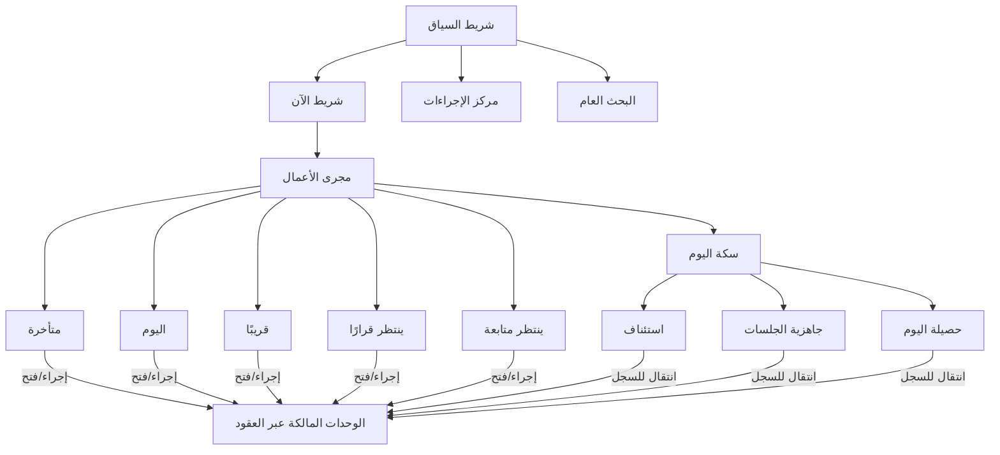

# الاتجاهات التصميمية والتصور المختار — «مكتب اليوم»

| الحقل | القيمة |
|---|---|
| الصفحة | «مكتب اليوم» — مركز العمل اليومي |
| المرحلة | تصميم وتحليل فقط |
| الحالة | **مقترح — بانتظار الاعتماد** |
| التاريخ | 2026-10-18 |
| الوثيقة الأم | `HOME_VISION.md`، `HOME_USER_JOURNEYS.md` |
| المخرج | ثلاثة اتجاهات + مقارنة + تصور هجين موصى به |

---

## 1. معايير المقارنة

المقارنة تجري على المعايير الاثني عشر التي حددها الأمر، لكل معيار وزن نسبي في المكتب القانوني اليومي (مرتفع/متوسط/منخفض)، والوزن نفسه معلَّن لا مخفي:

| # | المعيار | الوزن | لماذا |
|---|---|---|---|
| C1 | سرعة الوصول إلى العمل | مرتفع | جوهر الصفحة |
| C2 | وضوح الأولويات | مرتفع | سبب وجود الصفحة |
| C3 | سهولة الاستخدام اليومي | مرتفع | تكرار يومي مرهق |
| C4 | كفاءة تجربة الهاتف | مرتفع | خط الأساس Android (ADQ-39) |
| C5 | سهولة البحث والتنقل | مرتفع | J6 |
| C6 | تقليل الازدحام | مرتفع | خصم صريح ضد لوحة الإحصاءات |
| C7 | قابلية التخصيص | متوسط | نظام عام مستهلك |
| C8 | الأداء | مرتفع | مئات آلاف الملفات (REQ-013) |
| C9 | قابلية التوسع | متوسط | وحدات مستقبلية |
| C10 | سهولة الصيانة | متوسط | لا أنظمة موازية |
| C11 | ملاءمة المستخدمين المختلفين | مرتفع | 5 أدوار دراسية |
| C12 | الجودة البصرية | متوسط | مهمة لكنها ليست المقياس الأول |

## 2. الاتجاه (أ) — «مركز الأولويات» (Priority Hub)

**الفكرة:** اليوم **طابور عمل موحد**: صف واحد لكل عمل مستحق، مرتّب حسب الاستحقاق التشغيلي، وفوقه شريط محدود «الآن». لا أقسام متعددة بل قائمة واحدة تُرشَّح وتنثني.

```
┌────────────────────────────────────────────────────────────┐
│ شريط السياق: [القاعدة النشطة ▾] [بحث…] [المزامنة] [المستخدم] │
├────────────────────────────────────────────────────────────┤
│ الآن: جلسة 10:30 … | مهمة متأخرة منذ 3 أيام | +2          │
├────────────────────────────────────────────────────────────┤
│ مجرى الأعمال                                             │
│ ▸ متأخرة (4)                                              │
│   ○ مهمة — مراجعة لائحة — ملف: كذا — [افتح] [سجّل نتيجة]  │
│ ▸ اليوم (7)                                               │
│   ○ جلسة — محكمة … — ملف: كذا — [افتح الملف]              │
│ ▸ قريبًا (12) … ▸ ينتظر قرارًا (2) … ▸ ينتظر متابعة (5)  │
└────────────────────────────────────────────────────────────┘
```

| القوة | الضعف |
|---|---|
| أسرع وصول للعمل (C1) وأوضح أولويات (C2) | قلة المساحة الجانبية للسياق (جلسات/استئناف) |
| أداء ممتاز: استعلام واحد محدود لكل شريحة (C8) | قد يبدو «قائمة مهام» عامية لو أُسيء التصميم البصري |
| تطبيق مباشر على الهاتف (C4) | لا يجيب عن «أين توقفت؟» و«حصيلة اليوم» وحده |
| صيانة بسيطة وتوسع سهل (C9/C10) | — |

## 3. الاتجاه (ب) — «مساحة العمل المتكاملة» (Workbench)

**الفكرة:** المكتب المصغر: مناطق ثابتة متعددة، كل منطقة لنوع عمل (جلسات، متابعات، مهام، سياق)، ومركز سياق جانبي. غني وشامل، لكنه كثيف.

```
┌────────────────────────────────────────────────────────────┐
│ شريط السياق: [القاعدة] [بحث…] [المزامنة] [إجراءات جديدة ▾] │
├──────────────────────┬─────────────────────────────────────┤
│ جلسات الأسبوع        │ استئناف: ملف كذا                    │
│ ○ أ. ب. ج            │ آخر فتح: موكل كذا                   │
├──────────────────────┤─────────────────────────────────────┤
│ متابعات مستحقة (8)   │ حصيلة اليوم: أنجز 3 | بقي 9        │
│ ○ ○ ○                │ تنتظر قرارًا: 2                     │
├──────────────────────┤                                     │
│ مهام اليوم (5)       │                                     │
│ ○ ○                  │                                     │
└──────────────────────┴─────────────────────────────────────┘
```

| القوة | الضعف |
|---|---|
| سياق غني و«مكتب» متكامل (C11) | ازدحام مرتفع (C6 ضعيف)؛ تكرار محتمل لعينات الأعمال |
| مناطق قابلة للتخصيص بسهولة (C7) | تشتت بصري: أربع مصادر للانتباه في نظرة واحدة |
| مرن للتوسع (C9) | على الهاتف تنهار المناطق إلى تمرير طويل (C4) |
| — | أداء أثقل: عدة استعلامات عند الفتح (C8) |

## 4. الاتجاه (ج) — «اليوم خط زمني» (Day Timeline)

**الفكرة:** اليوم خط من الصباح إلى الإغلاق؛ الجلسات والمواعيد علامات زمنية، والمهام تتدفق حولها في الفراغات. قوي في التخطيط، ضعيف في «المتأخر والمرجَّل».

```
┌────────────────────────────────────────────────────────────┐
│ 09:00 ── مهمة: مراجعة لائحة                                 │
│ 10:30 ── جلسة: محكمة … (ملف: كذا) [جاهزية: 2/3]            │
│ 12:00 ── فراغ                                                │
│ 13:00 ── موعد: مقابلة موكل                                  │
│ 15:00 ── متابعة: استلام مستند (متأخرة منذ أمس) ⚠            │
│ نهاية اليوم ── [أغلق اليوم: الحصيلة]                       │
└────────────────────────────────────────────────────────────┘
```

| القوة | الضعف |
|---|---|
| ممتاز لليوم ذي الجلسات المتعددة (J1/J2) | الأعمال بلا وقت محدد (مهمة بلا موعد) لا تجد مكانًا طبيعيًا |
| «فراغات اليوم» فكرة تخطيطية جذابة | المتأخر والمرجَّل «خارج الخط» فيصبح مهمشًا (C2 ضعيف) |
| سرد بصري جميل (C12) | تعقيد التفاعل وصعوبة التخصيص (C7/C10) |
| — | على الهاتف: خط زمني رأسي مطول وبيانات قليلة لكل بند (C4 متوسط) |

## 5. جدول المقارنة الشامل

التقييم: ممتاز / جيد / مقبول / ضعيف.

| المعيار | (أ) مركز الأولويات | (ب) مساحة العمل | (ج) خط زمني |
|---|---|---|---|
| C1 سرعة الوصول للعمل | **ممتاز** | جيد (تعدد مناطق) | جيد (اليوم المرتبط بوقت) |
| C2 وضوح الأولويات | **ممتاز** (شرائح + سبب) | مقبول (توزيع بلا ترتيب واحد) | ضعيف (المتأخر مهمش) |
| C3 سهولة الاستخدام اليومي | **ممتاز** | جيد | جيد للجلسات فقط |
| C4 كفاءة الهاتف | **ممتاز** (قائمة واحدة) | ضعيف (انهيار المناطق) | مقبول |
| C5 البحث والتنقل | جيد | جيد | مقبول |
| C6 تقليل الازدحام | **ممتاز** | ضعيف | جيد |
| C7 قابلية التخصيص | جيد (شرائح/أعمدة صف) | **ممتاز** (مناطق) | ضعيف |
| C8 الأداء | **ممتاز** (استعلامات محدودة) | مقبول (تعدد الاستعلامات) | جيد |
| C9 قابلية التوسع | جيد | **ممتاز** | مقبول |
| C10 سهولة الصيانة | **ممتاز** | جيد | مقبول |
| C11 ملاءمة الأدوار | جيد | **ممتاز** (مناطق لكل دور) | مقبول |
| C12 الجودة البصرية | جيد | جيد | **ممتاز** (سردي) |

## 6. الاختيار: التصور الهجين «المجرى والسكة» (Day Stream & Rail)

**التوصية: تصور هجين** يتخذ **(أ) عمودًا فقريًا**، ويأخذ من **(ب)** السياق المنظم في سكة جانبية محدودة، ومن **(ج)** عنصرًا واحدًا موجزًا: عرض الجلسات القادمة على مسار قربته الزمني **دون** جعل الزمن هيكل الصفحة.

### 6.1 الاسم والهيكل

**«مكتب اليوم: مجرى الأعمال + سكة اليوم»** — خمس مناطق وظيفية لا أكثر:

| المنطقة | الاسم المعتمد في التصميم | المحتوى | مأخوذة من |
|---|---|---|---|
| 1 | **شريط السياق** | القاعدة النشطة + التبديل + البحث + حالة الاتصال/المزامنة + المستخدم + «إجراء جديد» | (ب) |
| 2 | **شريط «الآن»** | ما يحتاج انتباهًا فوريًا (حد أقصى مقترح 5 + «عرض الكل») | (أ) |
| 3 | **مجرى الأعمال** | قائمة موحّدة بشرائح: متأخرة ← اليوم ← قريبًا ← ينتظر قرارًا ← ينتظر متابعة | **(أ) — البطل** |
| 4 | **سكة اليوم** | ثلاث وحدات مصغّرة: استئناف ← جاهزية الجلسات ← حصيلة اليوم | (ب) + (ج) |
| 5 | **مركز الإجراءات** | إجراءات سريعة + إجراءات الصفوف السياقية | (ب) |

### 6.2 لماذا هذا الهجين تحديدًا

1. **يجيب عن الأسئلة العشرة دون عشر بطاقات:** (أ) وحده يجيب عن Q1–Q6؛ سكة (ب) تضيف Q3/Q9/Q10؛ مركز الإجراءات والبحث يجيبان Q7/Q8. لا سؤال بلا عنصر، ولا عنصر بلا سؤال.
2. **يحافظ على الأداء:** المجرى استعلامات محدودة لكل شريحة؛ السكة ثلاث استعلامات مصغّرة قابلة للفشل المستقل؛ لا «شاشة استعلامات» عند الفتح.
3. **الهاتف أولًا:** قائمة واحدة تعيش على 320px بكرامة؛ السكة تصبح أقسامًا تسلسلية تحت المجرى، لا أعمدة تنهار.
4. **يتجنب التكرار (P3):** العمل يظهر في المجرى مرة واحدة؛ وحدة جاهزية الجلسات تعرض **الجاهزية** (ملخص أعمال الجلسة) لا نسخة ثانية من المهمة.
5. **قابل للتخصيص ضمن المنظومة العامة:** إظهار/إخفاء/ترتيب السكة والشرائح مفاتيح `home.*` مألوفة (تتوافق مع L1 في `CLIENTS_CUSTOMIZATION.md`).
6. **يتوسع دون إعادة تصميم:** وحدات مستقبلية (مالية، مستندات) تُضاف كوحدات سكة اختيارية أو تصفية نوع في المجرى، لا كمنطقة جديدة مفروضة.

### 6.3 ما رُفض من كل اتجاه ولماذا

| العنصر | القرار | السبب |
|---|---|---|
| مناطق (ب) المتعددة المتساوية للمهام/المتابعات | **رُفضت** | تكرار بصري وازدحام؛ تحل محلها التصفية داخل المجرى |
| الخط الزمني الكامل في (ج) | **رُفض** | مهمش الأعمال بلا وقت؛ يخالف C2 |
| «فراغات اليوم» في (ج) | **رُفضت للإصدار الأول** | قيمة غير مثبتة؛ تحتاج بيانات أحمال لا توجد |
| لوحة إحصاءات تقليدية | **رُفضة صراحة** | الأمر §1، P1، P10 |
| بطاقات ملونة مكررة لكل نوع | **رُفضت** | ازدحام + «جميل بلا فعل» |

### 6.4 المخطط التخطيطي للتصور المختار

**الكمبيوتر (≥1024px):**

```
┌──────────────────────────────────────────────────────────────────────┐
│ شريط السياق: [القاعدة النشطة ▾]│[بحث شامل…        ]│[● متزامن][مستخدم]│
├─────────────────────────────────────────────┬────────────────────────┤
│ الآن: [جلسة 10:30] [متأخرة 3ي] [+2]        │  سكة اليوم             │
├─────────────────────────────────────────────┤ ┌────────────────────┐ │
│ مجرى الأعمال                                │ │ استئناف            │ │
│ ▸ متأخرة (4)                                │ │  • ملف كذا ←       │ │
│   [نوع] العنوان — سبب الظهور — سياق — إجراء │ ├────────────────────┤ │
│ ▸ اليوم (7)                                 │ │ جاهزية الجلسات     │ │
│ ▸ قريبًا (12)                               │ │  • جلسة الغد 2/3   │ │
│ ▸ ينتظر قرارًا (2)                          │ ├────────────────────┤ │
│ ▸ ينتظر متابعة (5)                          │ │ حصيلة اليوم        │ │
│ [ + إجراء جديد ]                            │ │  أنجز 3 • بقي 9    │ │
└─────────────────────────────────────────────┴────────────────────────┘
```

**الهاتف (≤767px):** المجرى كامل العرض، والسكّة أقسام تالية بنفس الترتيب، وشريط إجراءات سفلي ثابت.



## 7. ملاحظة على «الجمال»

> التصور المختار ليس الأجمل في لقطة شاشة ثابتة؛ (ج) أكثر سردية و(ب) أكثر ثراءً بصريًا. الاختيار مبني على أن جمال أداة العمل اليومية يأتي من **الوضوح والسرعة والراحة في الاستخدام الطويل** (C1/C2/C3/C6)، وأن الجمال البصري يُحقَّق في هذا الهجين بجودة التنفيذ الطباعي واللوحي الموصوفة في `HOME_VISUAL_DESIGN.md`، لا بمضاعفة العناصر. وهذا متوافق صراحة مع توجيه الأمر: «لا تجعل الجمال البصري على حساب السرعة أو وضوح المعلومات».
