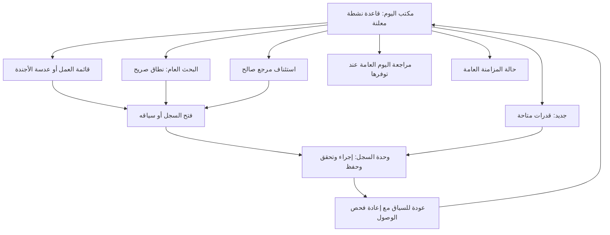

# بنية المعلومات وقواعد العمل المعروض

> **مقترح للاعتماد:** ترتيب المجموعات وأحكام الاستحقاق ونافذة القادم ليست قواعد قانونية ولا حالات أعمال جديدة. تعتمد على HC-02…HC-05، وتحتاج HD-02/03/04/05. التعريفات المعتمدة في [نموذج المجال](../DOMAIN_MODEL.md) لا تتغير.

## 1. المساحات ومسؤولية كل منها

| المعرف | المساحة | المحتوى | الظهور الافتراضي وشرطه |
|---|---|---|---|
| H-01 | سياق التطبيق | ميزان، اسم القاعدة النشطة، تبديل آمن، المستخدم | دائم؛ لا أسماء قواعد غير مصرح بها |
| H-02 | بوابة البحث | مدخل واحد للبحث العام ونطاق معلن | موضع علوي على الكمبيوتر وسفلي على الهاتف؛ فقط عند توفر الخدمة |
| H-03 | بدء العمل والتنقل | «جديد» و«الأقسام»، إجراءات متاحة فعلًا | دائم للقدرات المتاحة؛ لا زر فارغ أو قائمة وظائف مستقبلية |
| H-04 | رأس يوم العمل | «مكتب اليوم»، تاريخ اليوم ومنطقته عند الحاجة، نطاق الشخص، عدسة ومرشحات | دائم؛ يُظهر حدود المرشح، لا يوسعه صامتًا |
| H-05 | دفتر العمل | مجموعات أسباب، صفوف الأعمال، الوصول إلى القوائم الكاملة | المساحة الرئيسية؛ يمكن اختصار تفاصيلها لا إزالة الوصول إلى الأعمال |
| H-06 | سياق العنصر المختار | المصدر، الروابط، نتيجة سابقة واستعداد مسجّل وإجراءات المالك | عند الطلب فقط؛ عمود على الكمبيوتر، مساحة كاملة على الهاتف |
| H-07 | استئناف | حتى ثلاثة مراجع صالحة من التنقل العام | اختياري، بعد الأعمال، عند توفر بيانات مشروعة فقط |
| H-08 | مراجعة اليوم | رابط تقرير/عرض المراجعة العام | عند توفر HC-12؛ لا إحصاءات بديلة عند غيابه |
| H-09 | حالة التشغيل والسلامة | الاتصال بالمزامنة، انتظارها، التعارض، التغطية والحداثة | مؤشر هادئ دائم عند توفر عقد الحالة؛ شريط استثناء فقط عند الحاجة |
| H-10 | تخصيص العرض | كثافة/أقسام/أوضاع وإعادة ضبط | عبر نظام التخصيص العام فقط |

لا شريط جانبي دائم خاص بالصفحة في الاقتراح. «الأقسام» جزء من غلاف التطبيق العام، فلا يُنشأ تنقل موازٍ. مساحة H-06 ليست شرطًا لفتح السجل؛ عنوان الصف يفتحه مباشرة حتى إن لم يُنفّذ المالك معاينة.

## 2. خريطة التنقل المقترحة

الرسم وصف ملاحي، لا مخطط مكونات تقنية. البيانات لا تُنقل بين قواعد بسبب انتقال المستخدم.

## 3. النطاق الافتراضي ومعنى اليوم

- **القاعدة:** النشطة فقط. البحث الشامل وضع مستقل ضمن القواعد المتاحة **محليًا**، حتى عند الاتصال، وفق ADQ-41. تجميع أعمال كل القواعد ليس افتراضًا للإصدار الأول.
- **المستخدم:** «المتاح لي» افتراضي مقترح. «مسند إليّ» خيار فقط للمصادر التي تملك إسنادًا معتمدًا. يُبين المرشح إن كان لا يشمل مصادر بلا إسناد، مع رابط إزالة المرشح، لا تسقط بصمت.
- **اليوم:** تاريخ محلي صادر عن سياق الزمن العام؛ اختيار منطقة العرض العامة يحتاج HD-04. لا تُشتق مصر/القاهرة من موقع الجهاز أو موقع صاحب المشروع تلقائيًا.
- تاريخ بلا وقت يبقى تاريخًا؛ لا يحول إلى ساعة صفر. الاستحقاق ذي الوقت له منطقة/مرجع واضح. حدود اليوم تتبع التقويم والمنطقة المعتمدين، لا افتراض أن كل يوم 24 ساعة.
- وقت الاستعلام/العرض، وقت آخر تعديل، وآخر مزامنة ناجحة **قيم مختلفة**. تغيير يوم العرض ليس تغييرًا للسجلات.
- المقترح لـ«القادم»: من الغد إلى نهاية اليوم السابع بعد اليوم الحالي، أيام تقويمية لا أيام عمل قانونية. نافذة قابلة للاعتماد، لا آجال إجرائية ولا حساب عطلات.
- لا تبني الصفحة تذكيرًا تلقائيًا قبل الجلسة بساعتين أو يوم، ولا تعتبر نقص المستندات سببًا للاستحقاق إلا إذا عاد من مالك معتمد.

## 4. أهلية السجل للعرض

ينفذ تطبيق الصلاحيات **قبل** إرجاع العنوان أو العدد أو أي سبب. بعده تُطبق قواعد العرض المقترحة:

| حالة المصدر | ما تفعله الصفحة |
|---|---|
| عمل مفتوح وله موعد/انتظار/متابعة يقرها المصدر | يدخل العرض وفق المجموعة الوحيدة المحددة أدناه |
| مكتمل أو ملغى | لا يدخل المستحق؛ قد يظهر في تقرير صحيح أو بحث حسب المصدر |
| سجل العمل في السلة | مقترح: لا يدخل المستحق، ويظل في مسار السلة العام؛ HD-05، لا اعتماد من PR #2 |
| مؤرشف | الأرشفة ليست إتمامًا. يحدد المالك أهلية العمل؛ لا تُسقط مهمة مفتوحة لأن ملفها مؤرشف |
| قاعدة مؤرشفة للقراءة فقط | قراءة مأمونة بحسب المالك؛ لا أفعال كتابة أو «إتمام» |
| مصدر بلا دلالة حالة أو موعد كافية | لا يُصنف تخمينًا؛ تُعرض محدودية التغطية، ولا يقال «لا أعمال» |
| نتيجة/موعد متعارض | تُعرض حالة عدم اليقين من المالك؛ لا اختيار تلقائي لأحد التاريخين ولا تأخر محسوب من قيمة غير محسومة |
| روابط متعددة للملفات/الأطراف | سجل عمل واحد، وقائمة روابط مصرح بها عند الطلب |

لا يُنشأ «عمل» من آخر زيارة للملف أو قِدم تعديله. متابعة ملف بلا مهمة ممكنة فقط إذا قدّم المالك **حاجة متابعة مسجلة** بهوية وسبب وإجراء واضحين.

## 5. اقتراح المجموعات — تصنيف عرض لا دورة حياة

| المجموعة | سبب العضوية | موضعها |
|---|---|---|
| W1 — يحتاج انتباهًا | إشارة صريحة من المالك تستلزم انتباه المستخدم الآن: مراجعة مطلوبة أو عائق مؤثر مسجّل. يجب أن تتضمن السبب والمرجع | أعلى عدسة العمل؛ لا تنشئ الصفحة «عاجل» من تلقاء نفسها |
| W2 — متأخر | عمل مفتوح يؤكد المالك قابلية استحقاقه، ومرّ موعده المسجّل وفق دلالة الزمن | بعد W1، مع الموعد الأصلي والسبب |
| W3 — اليوم | حدث يقع اليوم أو عمل يستحق اليوم، ولم يدخل W1/W2 | مجموعة واحدة، مع النوع ودلالة الموعد |
| W4 — بانتظار قرار | انتظار صريح بلا موعد يضعه في مجموعة زمنية | بعد اليوم؛ صاحب القرار إن كان متاحًا |
| W5 — متابعة بلا موعد | انتظار متابعة أو عمل مفتوح بلا موعد يقر المالك صراحة أهليته لهذه القائمة | بعد انتظار القرار؛ لا يُعرض كمتأخر |
| W6 — القادم | حدث/استحقاق مستقبلي ضمن نافذة القادم، ولم يدخل W1 | عدسة/مرشح «القادم»، لا قائمة ثانية تكرر العناصر |
| المنجز | إتمام أو نتيجة موثقة بتاريخها | خارج المستحق، في HC-12 أو مرشح مصدر معتمد؛ لا حالة تستنتج من مرور اليوم |

### 5.1 قاعدة الإسناد الوحيدة

تُفحص الأهلية أولًا. ثم: إشارة انتباه صريحة ← استحقاق متجاوز صحيح ← اليوم ← موعد قادم ضمن النافذة ← انتظار قرار بلا موعد ← متابعة بلا موعد. يؤخذ **أول سبب منطبق فقط** كموضع للسجل. هذا ترتيب تصنيف لا وزن قانوني.

- مهمة متأخرة وتنتظر قرارًا: صف واحد في W2، وشارة «بانتظار قرار».
- جلسة اليوم ولها مهام استعداد: الجلسة سجل، وكل مهمة مستقلة سجل آخر؛ تُعرض العلاقة، ولا تُحتسب المهمة مرة ثانية في المعاينة.
- جلسة مضت ساعتُها اليوم: لا تصبح «مهمة متأخرة» لمجرد مرور الوقت؛ تبقى حدث اليوم بحسب حالتها. طلب تسجيل نتيجتها يحتاج إشارة معتمدة من المصدر.
- جلسة أمس بلا نتيجة: لا تخلق الرئيسية لها مهمة متأخرة. المالك يقرر إن كانت بحاجة تسجيل نتيجة ويصدر السبب. غياب هذه الدلالة اعتماد ناقص لا قاعدة بديلة.
- موعد داخلي ليس جلسة، وتاريخ تسجيله ليس موعد حدوثه. لا يُستعمل الإنشاء أو التعديل أو المزامنة بديلًا عن تاريخ استحقاق مفقود.
- مهمة بتاريخ فقط تصبح متأخرة بعد انتهاء ذلك التاريخ المحلي؛ مهمة بوقت استحقاق صريح قد تصبح متأخرة في اليوم نفسه. ذلك **استحقاق مسجل** لا تقرير سقوط حق أو فوات ميعاد قانوني.

### 5.2 ترتيب العناصر داخل المجموعة

ترتيب افتراضي مقترح معلن في «كيف رُتبت الأعمال؟»:

1. الموعد المسجّل الأقرب زمنيًا أولًا؛ وفي المتأخر، الأقدم استحقاقًا أولًا.
2. في اليوم نفسه: العناصر ذات الوقت مرتبة بالوقت؛ مجموعة فرعية واضحة «وقت غير مسجّل» للبيانات التاريخية فقط، لا ساعة افتراضية.
3. بلا موعد: ترتيب ثابت بمرجع السجل. إن اعتمد المالك تاريخ دخول الانتظار يمكن استخدامه لاحقًا بقرار؛ لا نستخدم «آخر تعديل» خفية.
4. التعادل يُحسم بمرجع ثابت من المالك يحفظ الاستقرار عبر الصفحات، لا نوع العمل ولا الاسم ولا حجم الأتعاب.

يظل زر «اليوم» ظاهرًا للانتقال إليه مباشرة مهما كثر المتأخر. لا يفهم تقديم W2 على W3 أن كل متأخر أهم قانونيًا من كل جلسة؛ العناوين تشرح التنظيم ويمكن مراجعة ترتيبه في HD-02.

### 5.3 منع التكرار والعدّ

- هوية العرض: نطاق التثبيت + القاعدة عند انطباقها + نوع المصدر + المرجع الأصلي. الأسماء والأرقام المعروضة ليست مفتاحًا للتوحيد.
- إذا قدّم مصدران **نفس العمل**، لا يُقبل كلاهما في الدفتر إلا بعد تحديد مالك ومرجع قانوني واحد له في HC-02. لا إزالة تكرار احتمالية على أساس عنوان مشابه.
- شخص واحد في قاعدتين لا يدمج سجلي عمل؛ قضية واحدة مرتبطة بملفين لا تصبح قضيتين في القائمة.
- العدادات لنتائج **مصرح بها** في النطاق واللقطة نفسيهما، وليست أحجامًا كلية للمكتب. لا يُجمع عدد الجلسات وعدد المهام بوصفه إنجازًا قانونيًا موحدًا.
- إذا لم يعرف المصدر العدد الدقيق: «المزيد متاح» أو «العدد غير متاح»، لا رقم تقديري بصيغة دقيقة ولا صفر.

## 6. هيكل سطر العمل

الترتيب المنطقي ثابت على الأجهزة:

1. **النوع + العنوان الأصلي القابل للفتح**؛ الحالة نصًا إذا كانت مؤثرة.
2. **الموعد بدلالته**: «جلسة»، «موعد»، «استحقاق»، أو «بلا موعد»؛ والجهة/المحكمة للجلسة عند توافرها.
3. **سياق مختصر**: القضية/المسار ثم الملف أو عدد الروابط المتاحة؛ المسؤول إن كان المصدر يدعمه.
4. **سبب الظهور**، ثم إجراء سياقي واحد متاح، و«تفاصيل» عند دعم المعاينة؛ بقية الأفعال في قائمة مسماة.

لا أرقام قومية أو أرصدة أو نص مذكرات في الصف. العنوان يُلف ولا يُخفي النوع أو الموعد؛ النصوص الطويلة يُتاح أصلها بفتح السجل، لا عبر Hover فقط. لا مربع «تم» عام لأن معنى الإتمام يختلف بين الأنواع.

## 7. الجلسات والاستعداد والأعمال الإدارية

| العنصر | ملخص القائمة | التفاصيل عند الطلب |
|---|---|---|
| جلسة | تاريخ/وقت مسجّل، محكمة، قضية/مسار، حالة | روابط الملفات والأطراف بصفاتهم، آخر نتيجة مسجلة مع تاريخها، ملاحظات الاستعداد المصرح بها، مهام مرتبطة وروابط مستندات |
| موعد | تاريخ/وقت الحدث، وصفه، جهة أو شخص إن أتاح المصدر | المالك والسياق والإجراء التالي؛ ليس جلسة لمجرد ارتباطه بقضية |
| مهمة | وصف العمل، استحقاق، حالة، مسؤول إن وجد | الملف/القضية/الإجراء المرتبط وشروط العمل التي يحددها مالكها |
| إجراء إداري/متابعة | نوعه ووصف قصير وحالته وموعده إن وجد | الجهة والملف والمسؤول والإجراء التالي الحقيقي |

تجميع متابعات نفس الجهة/الملف خيار لاحق للعرض؛ كل سجل يحتفظ بهويته وموعده وإجرائه، ولا إجراء جماعي من الرئيسية دون مواصفة واعتماد مستقلين.

## 8. يوم هادئ ويوم مزدحم

**الهادئ:** إن كانت التغطية مكتملة للمصادر المتاحة والمرشحات واضحة، تظهر «لا توجد أعمال مستحقة اليوم ضمن هذا النطاق». يظل البحث و«جديد» والتنقل. «القادم» أو «استئناف» يظهران فقط ببيانات حقيقية؛ لا نسب نجاح أو تنبيهات مصطنعة. إذا غابت المصادر يقول التصميم إن العرض غير متاح/غير مكتمل، لا إن المكتب خالٍ من العمل.

**المزدحم:** مقترح أولي: معاينة حتى **3 عناصر لكل مجموعة على الهاتف، و5 على الكمبيوتر**، مع رؤوس كل المجموعات المتاحة وروابطها. حد المعاينة ليس حدًا لعدد الأعمال. عنوان المجموعة يفتح قائمة كاملة بدفعات **20** عنصرًا مع «التالي/السابق»؛ لا تمرير لا نهائي إجباري. لا تستحوذ W1 على كل الميزانية وتمنع ظهور مدخل W2/W3. حدود الدفعات تحتاج HD-16 واختبارًا فعليًا.

يُعرض ملخص وصول نصي محمي إلى مجموعات الأعمال، لا بطاقات أرقام. عند إخفاء التفاصيل بالتخصيص أو اختيار الأجندة يبقى مدخل «كل الأعمال» وأسباب الاستثناء المتاحة. فشل مجموعة لا يعطل البقية، وتغطيتها منفصلة.

## 9. الفصل بين العدسات

- **العمل:** الافتراضي، W1…W5 بحسب الأهلية.
- **الأجندة:** الجلسات والمواعيد فقط، بنفس المراجع والحالات، مجمعة باليوم والوقت. لا إدراج مهمة كحدث إلا إذا كانت علاقتها بموعد سجلًا فعليًا لدى المالك.
- **القادم:** مرشح زمني لجميع أنواع العمل المؤرخة، W6، مع نافذة معلنة.
- التبديل يستبدل القائمة الحالية ويحفظ موضع كل عدسة في الجلسة؛ لا يعرض نسختين من العمل. مدخل الاستثناءات المحمي لا يسرد الصفوف مرة أخرى.

التفاعل الدقيق في [مواصفات UX](HOME_UX_SPECIFICATION.md)، وشروط الإخفاء في [التخصيص](HOME_CUSTOMIZATION.md)، ومطابقة المصدر في [العقود](HOME_DATA_CONTRACTS.md).
