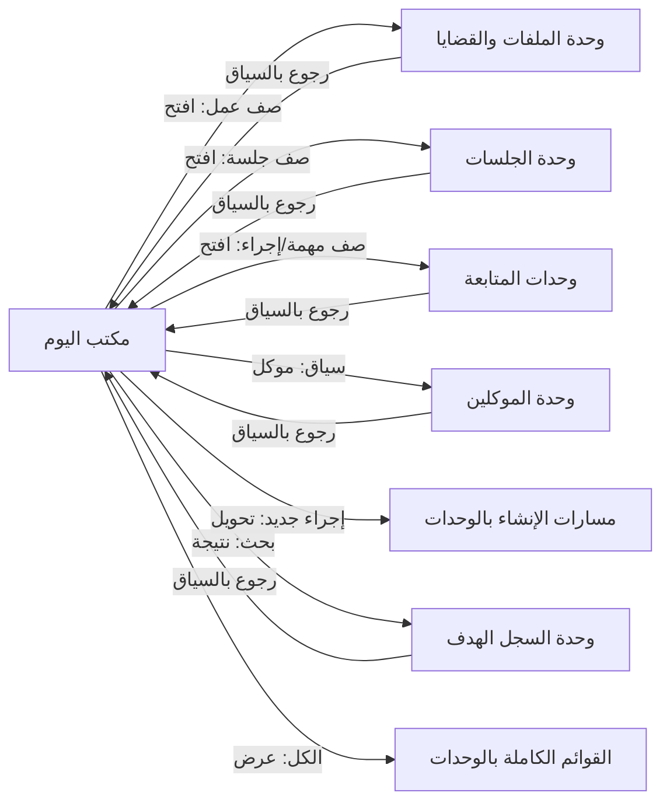

# بنية المعلومات والأولويات — «مكتب اليوم»

| الحقل | القيمة |
|---|---|
| الصفحة | «مكتب اليوم» — مركز العمل اليومي |
| المرحلة | تصميم وتحليل فقط |
| الحالة | **مقترح — بانتظار الاعتماد** |
| التاريخ | 2026-10-18 |
| الوثيقة الأم | `HOME_DESIGN_ALTERNATIVES.md` (التصور المختار)، `HOME_UX_SPECIFICATION.md` |

---

## 1. مناطق الصفحة الخمس وترتيبها المنطقي

الترتيب المنطقي (وفي RTL: شريط السياق أعلى الصفحة، والمجرى في المنطقة الرئيسية اليمنى، والسكة في الجانب الأيسر) ثابت قابل للتوسعة:

| # | المنطقة | الترتيب المنطقي | الارتفاع التقريبي | قابلة للإخفاء بالتخصيص |
|---|---|---|---|---|
| 1 | شريط السياق | أولى، ثابتة دائمًا | صف واحد | لا (تحوي البحث والقاعدة والحالة) |
| 2 | شريط «الآن» | ثانية، فوق المجرى | صف واحد قابل للتوسيع | نعم (مع بقاء الوصول البديل) |
| 3 | مجرى الأعمال | ثالثة، **البطل** | بقية الارتفاع | لا (جوهر الصفحة) |
| 4 | سكة اليوم | رابعة (جانبية / تالية على الهاتف) | ثلاث وحدات مصغّرة | نعم (وحدة وحدة) |
| 5 | مركز الإجراءات | ضمن شريط السياق + على الصفوف | زر/قوائم | إخفاء الزر لا يُلغي الإجراءات السياقية |

## 2. مجرى الأعمال — التصميم المعلوماتي

### 2.1 مبدأ البناء

> المجرى **عرض استعلامي موحّد** فوق سجلات الوحدات الأصلية: لا كيان «عمل مستحق» جديد، ولا جدول أعمال موازٍ (E-05، P5). يُبنى كل صف من: نوع السجل + استحقاقه المسجَّل + حالته المسجَّلة.

### 2.2 شرائح الاستحقاق

| الترتيب | الشريحة | معيار الظهور (كله من بيانات مسجَّلة) | الافتراضي |
|---|---|---|---|
| 1 | **متأخرة** | موعد استحقاق مسجَّل مضى ولم يكتمل العمل | مفتوحة |
| 2 | **اليوم** | استحقاق مسجَّل في اليوم المحلي (وفق ADQ-15) | مفتوحة |
| 3 | **قريبًا** | استحقاق مسجَّل ضمن نافذة زمنية قادمة | مطوية بعد 5 عناصر |
| 4 | **ينتظر قرارًا أو مراجعة** | حالة مسجَّلة صراحة «بانتظار قرار/مراجعة» | مفتوحة |
| 5 | **ينتظر متابعة** | حالة مسجَّلة «بانتظار متابعة» أو عمل بإجراء تالٍ معلَّق | مطوية |

**قواعد ضابطة:**

1. **لا يظهر عمل بلا سبب:** لكل صف شارة «سبب الظهور» مشتقة آليًا (مثال: «متأخرة — موعدها المسجَّل كان كذا»، «جلسة مسجَّلة اليوم»).
2. **المكتمل والملغى والمعلَّق نهائيًا لا يظهرون** في أي شريحة (P4)؛ مكانهم حصيلة اليوم أو لا شيء.
3. **العمل الواحد — الظهور الواحد** (P3): المهمة المرتبطة بجلسة تظهر في المجرى مرة واحدة؛ وداخل صف الجلسة تظهر أعمالها التحضيرية كقائمة فرعية مطوية، لا كصفوف مستقلة في «الآن».
4. **الأولويات معلَّنة لا مخفيّة:** الترتيب داخل الشريحة: الأقدم استحقاقًا أولًا، ثم الأقدم إنشاءًا، ثم استقرار المعرّف. لا خوارزمية وزن غامضة (`HD-01` يطلب اعتماد هذه القاعدة).
5. **حدود العرض:** كل شريحة تعرض حدًا أقصى مقترحًا (5) مع «عرض الكل (عدد)» ينقل إلى القائمة الكاملة في الوحدة المالكة أو عرض موسّع مصفّى.
6. **الإسقاط الصامت ممنوع** (P13): إذا تجاوزت الأعمال الحد، يظهر العداد الكلي للشريحة دائمًا.
7. **احترام الصلاحيات** (P6): التصفية على البيانات عند الاستعلام؛ ما لا صلاحية به لا يُحتسب حتى في العدادات.

### 2.3 أنواع صفوف العمل

| النوع | المصدر المنطقي (`DOMAIN_MODEL`) | أبرز الحقول المعروضة |
|---|---|---|
| جلسة | الجلسة | الوقت، المحكمة/الجهة، القضية/المسار، الملف، آخر نتيجة |
| موعد | الموعد | الوقت، الوصف، المرتبط |
| مهمة | المهمة | الوصف المختصر، الموعد، المرتبط |
| متابعة/إجراء | الإجراء | نوع العمل، الوصف، الحالة، الموعد، المرتبط |
| (مستقبليًا) بند مالي/مستند | — | لا يُعرض في الإصدار الأول `[معلّق — HD-10]` |

> التمييز بين الجلسة والموعد والمهمة والإجراء **مفهومي معتمد**؛ والصف يحافظ على النوع بوضوح (أيقونة + نص)، ولا يُدمج في «عنصر عام». والتصميم يفترض ظهور الجلسة المستحقة صفًا في المجرى مع جاهزيتها في السكة (الافتراضي المقترح في `HD-03` — بانتظار الاعتماد).

## 3. شريط «الآن»

| البند | القرار |
|---|---|
| الغرض | الإجابة المباشرة عن Q1 «ما يحتاجني الآن؟» |
| المحتوى المقصود | جلسات اليوم (بحسب وقتها)، والمتأخر الحاد، والمرجَّل العالق — **مشتقة من المجرى نفسه** لا مصدر مستقل |
| حد العرض | 5 عناصر مقترحة + «عرض المجرى كاملًا» |
| الشرط الحاكم | يظهر العنصر في «الآن» فقط إذا مُتَّحد ظهوره في المجرى (P3)؛ شريط «الآن» **مرشِّح لا مكرِّر** — بمعنى أنه يبرز من نفس الصفوف |
| الغياب | إذا لم يوجد ما يستحق الانتباه الفوري يُطوى الشريط برسالة واحدة هادئة، لا يُملأ بعناصر ضعيفة |

## 4. سكة اليوم — الوحدات الثلاث

| الوحدة | الغرض | مبدأ الحد |
|---|---|---|
| **استئناف** | Q9: العودة لآخر عمل | 3 عناصر أحدث فتحًا؛ كل عنصر: النوع + العنوان + القاعدة + وقت آخر فتح |
| **جاهزية الجلسات** | Q3 + J2: الاستعداد للجلسات القادمة | الجلسات القادمة المسجَّلة (نافذة `HD-09`) مع مؤشر جاهزية مشتق من أعمالها المسجَّلة فقط |
| **حصيلة اليوم** | Q10: أُنجز وبقي | بنود قابلة للنقر: أُنجز اليوم / بقي ومستحق / متأخر / نتائج جلسات اليوم / تنتظر قرارًا |

**قواعد مشتركة للسكّة:**

1. كل وحدة **مستقلة الفشل**؛ تعطلها يعرض حالتها ولا يمس المجرى.
2. كل عنصر داخلها **ينتقل إلى السجل الأصلي** لا إلى نسخة.
3. لا أرقام إجمالية صماء: كل مجموع قابل للنقر إلى بنوده (J10).
4. الوحدات الثلاث **قابلة للإخفاء والترتيب** بالتخصيص العام، مع بقاء الوصول البديل للمحتوى المهم عبر المجرى والقوائم الكاملة.

## 5. مركز الإجراءات

| البند | القرار |
|---|---|
| المظهر | زر رئيسي واحد «إجراء جديد» في شريط السياق + قائمة إجراءات سياقية على كل صف |
| القاعدة الحاكمة | إما يستدعي وظيفة وحدة مالكة عبر عقدها، أو **يُحجب** — لا «زر رمادي» يوحي بوظيفة موجودة (P5، P10) |
| القائمة المقترحة (تظهر بحسب التنفيذ والصلاحية) | موكل جديد، ملف قانوني جديد، مهمة جديدة، موعد جديد، تسجيل نتيجة، تسجيل متابعة |
| الاستثناء | «البحث الشامل» ليس إجراءً إنشائيًا؛ مكانه شريط السياق دائمًا |

## 6. التسمية العربية المعتمدة للعناصر (مقترحة للاعتماد)

| المفهوم | الاسم في الواجهة | ملاحظة |
|---|---|---|
| الصفحة | مكتب اليوم | الاسم الوظيفي المعتمد في الأمر |
| شريط السياق | بلا عنوان ظاهر | عناصره مسمّاة: «القاعدة النشطة»، «بحث» |
| شريط الانتباه | الآن | اسم قصير صريح |
| القائمة الموحدة | أعمال اليوم | لا «المهام» لتفادي الخلط بنوع السجل «مهمة» |
| الشرائح | متأخرة / اليوم / قريبًا / ينتظر قرارًا / ينتظر متابعة | — |
| شارة التبرير | سبب الظهور | — |
| السكة | اليوم (عناوين الوحدات) | استئناف / جاهزية الجلسات / حصيلة اليوم |
| الإجراءات | إجراء جديد | + إجراءات الصفوف بلا عنوان جماعي |

## 7. التنقل والعلاقة بالأقسام

### 7.1 قواعد التنقل

1. **من الصفحة إلى السجل:** خطوة واحدة (زر/رابط)، ويُفتح في الوحدة المالكة.
2. **العودة بالسياق:** يحتفظ الموضع بالمرشحات والشريحة المفتوحة ونص البحث عند العودة (P14).
3. **العمليات الجارية:** التبديل بين القاعدة النشطة وسواها يحترم ADQ-04 (استكمال أو إلغاء آمن).
4. **لا تنقل للبيانات:** الانتقال يفتح السجل الأصلي في قاعدته؛ لا نسخ صفحة للمصدر.

### 7.2 خريطة الانتقال

## 8. منع التكرار — قواعد صريحة

| الحالة | القاعدة |
|---|---|
| عمل مرتبط بجلسة ومستحق بنفسه | يظهر في المجرى بصف واحد يحمل الرابطين؛ لا يظهر في «الآن» مرتين |
| عينة من العمل في السكة (مثل ملخص أعمال جلسة) | روابط موجزة داخل صف الجلسة، لا صفوف مجرى |
| حصيلة اليوم تعرض عملًا ظهر في المجرى | مسموح لأن السياق مختلف (إحصاء اليوم vs استحقاق)، والعنصر مطوي حتى يُطلب |
| بحث يعيد سجلًا ظاهرًا في المجرى | مسموح؛ البحث مسار مستقل، ونتائجه لا تُدمج مع المجرى |

## 9. ملاحظة على الغياب والامتلاء

| الحالة | السلوك |
|---|---|
| لا أعمال مستحقة إطلاقًا | حالة هادئة: سبب الهدوء + القادمة المسجَّلة فعليًا (إن وُجدت) + الإجراءات والبحث كما هي (V-06) |
| ازدحام (عشرات) | حدود الشرائح + عدادات صادقة + «عرض الكل» + بقاء «الآن» ≤ 5 (V-07) |
| اختلاط مصادر (جلسات + مهام + متابعات) | الترتيب حسب الاستحقاق لا حسب النوع؛ التصفية بالنوع متاحة دائمًا |

> هذا القسم ينقل تفاصيل الحالات إلى `HOME_STATES_AND_ERRORS.md`؛ وما هنا قواعد بناء فقط.
