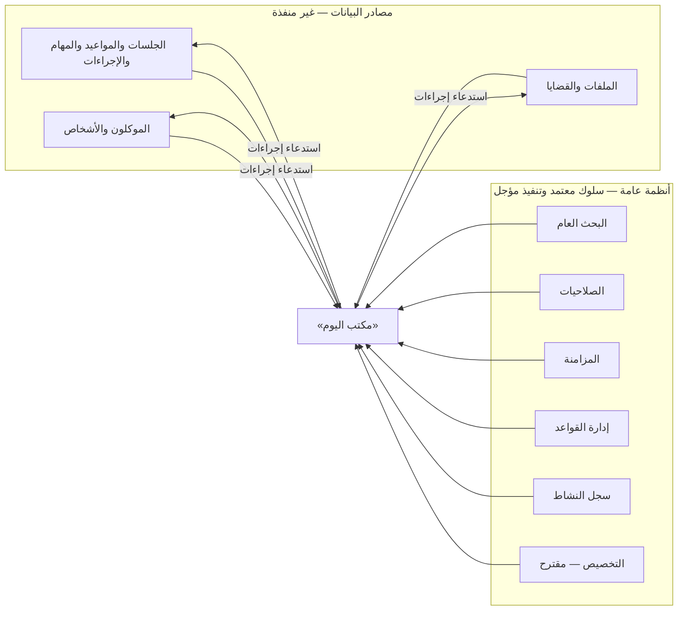

# تقييم المشروع — فحص الواقع قبل تصميم «مكتب اليوم»

| الحقل | القيمة |
|---|---|
| النوع | تقرير فحص للمستودع والقرارات والاعتماديات |
| المرحلة | تصميم وتحليل فقط |
| الحالة | **تقرير — وقائع مرصودة بتاريخ الفحص** |
| تاريخ الفحص | 2026-10-18 |
| الفرع | `arena/73944cb0-mizan-law` (منشأ من `d432e40` على `main`) |
| وثائق الصفحة | `HOME_VISION.md`، `HOME_DATA_CONTRACTS.md` |

---

## 1. نطاق الفحص والمنهجية

فُحصت الوثائق الفعلية في المستودع، لا ملخصاتها؛ وحالة Git وطلبات الدمج؛ والقرارات المعتمدة والمقترحة والمؤجلة. الأصل في كل ملاحظة: **الملف الموجود الآن**، لا الذاكرة ولا الافتراض.

| مصدر الفحص | النتيجة |
|---|---|
| `AGENTS.md` | إلزام بالقرارات المعتمدة، وفصل «نُفِّذ» عن «مقترح/مؤجل»، ومنع اتخاذ قرارات جوهرية |
| `README.md` | النطاق العام يتضمن «الصفحة الرئيسية ومركز العمل اليومي» صراحة |
| `docs/DECISIONS.md` | 45 قرارًا معماريًا معتمدًا (ADQ-01…ADQ-45) + قرارات وظيفية وتشغيلية |
| `docs/REQUIREMENTS.md` | 21 متطلبة (REQ-001…REQ-021) |
| `docs/DOMAIN_MODEL.md` | مسرد + تمييز مفاهيمي معتمد (ملف ≠ قضية؛ جلسة/موعد/مهمة/إجراء) |
| `docs/PROJECT_VISION.md`، `docs/ROADMAP.md` | النطاق العام والتسلسل التنظيمي — لا اعتماد لوظائف الإصدار الأول بعد |
| متطلبات المتخصصة (مزامنة، أمان، أداء، محاسبة، مستندات، نسخ، سلامة بيانات، قواعد) | سلوك معتمد + تفاصيل مؤجلة |
| `docs/OPEN_QUESTIONS.md`، `docs/TECHNICAL_DECISIONS_PENDING.md` | طرق تنفيذ وتفاصيل تخصصية مؤجلة — **منها تفاصيل مركز العمل اليومي صراحة** |
| `docs/clients/*` (13 وثيقة) | حزمة تصميم وحدة الموكلين — **مقترحة بانتظار الاعتماد** |
| طلبات الدمج | PR #1، #3…#8 مدمجة؛ **PR #2 ما زال مفتوحًا ولم يُمسَّ**؛ لا طلبات أخرى مفتوحة |
| الشيفرة وقاعدة البيانات | **لا يوجد كود تطبيق ولا مخطط قاعدة بيانات ولا بيانات تشغيل** — المستودع توثيقي بالكامل |

## 2. حالة المستودع الحقيقية

| البند | الموجود فعليًا | الأثر على «مكتب اليوم» |
|---|---|---|
| شيفرة تطبيق | لا يوجد | لا وظيفة «منفَّذة» إطلاقًا؛ كل التكامل مستقبلي |
| قاعدة بيانات أو مخطط | لا يوجد | عقود البيانات في هذه الحزمة مسودات فوق نموذج مفاهيمي |
| تقنيات معتمدة | لا توجد (كلها في `TECHNICAL_DECISIONS_PENDING.md`) | التصميم بصري وسلوكي بلا اختيار تقني |
| منظومة بحث | لا توجد — متطلبات سلوكية فقط (ADQ-41/42، REQ-010) | الصفحة تستهلك عقد بحث عام مقترح، لا تبني محركًا |
| منظومة تخصيص | لا توجد — مقترحة في `CLIENTS_CUSTOMIZATION.md` | الصفحة مستهلكة لنفس المنظومة العامة المقترحة |
| منظومة مزامنة | لا توجد — سلوك معتمد (ADQ-05، ADQ-14…19) | مؤشرات الصفحة مرتبطة بعقود مستقبلية |
| وحدات العمل (ملفات، جلسات، مهام، متابعات) | **لا توجد ولا حتى حزم تصميم لها** | مصادر صفوف العمل كلها `[غير منفذ]` — أكبر اعتمادية للصفحة |
| حزمة تصميم جاهزة للمقارنة | `docs/clients/` فقط | أسلوب التوثيق والعقود يستمر في حزمة `docs/home/` |

## 3. ما هو معتمد فعليًا ويرتبط بالصفحة

| القرار | النص الموجز | ارتباطه بـ«مكتب اليوم» |
|---|---|---|
| النطاق العام (`PROJECT_VISION`) | «الصفحة الرئيسية ومركز العمل اليومي» من نطاق المشروع | **السند الوظيفي للصفحة** |
| ADQ-02، ADQ-04 | قواعد مستقلة متعددة، تبديل آمن دون فقد عملية جارية | اسم القاعدة النشطة في شريط السياق؛ التبديل الآمن |
| ADQ-05، ADQ-18 | مزامنة عبر LAN/إنترنت + عمل محلي مستمر دون اتصال | كل واجهة الصفحة تعمل محليًا؛ مؤشرات صادقة |
| ADQ-15، ADQ-16 | التسلسل المنطقي والتوقيت؛ سياسات التعارض حسب الصنف | عرض «وقت الاستحقاق» بتوقيت مرجعي؛ تنبيهات التعارض |
| ADQ-17 | الانقطاع الطويل لا يُتلف العمل المحلي؛ تنبيه التباعد | حالة «بيانات قد لا تشمل تغييرات غير متزامنة» |
| ADQ-19 | الذرية ومنع تكرار الأثر | تنفيذ إجراء واحد = وحدة واحدة؛ لا صف «مكتمل جزئيًا» |
| ADQ-25 | الصلاحيات قيد فعلي لا إخفاء واجهة | التصفية على البيانات؛ رسائل «لا تملك صلاحية» |
| ADQ-31، ADQ-32 | السلة + الحذف النهائي الموثق؛ سجل تدقيق إلحاقي | الأعمال الملغاة خارج المجرى؛ تسجيل الإجراءات |
| ADQ-39 | خط الأساس: Windows اعتيادي + Android متوسط | معايير تصميم الهاتف والأداء المرجعي |
| ADQ-40 | الأرشفة قابلة للعكس وباقية في البحث والتدقيق | المؤرشف يُميَّز ولا يختفي صامتًا من المحفوظات |
| ADQ-41، ADQ-42 | البحث الشامل مع اسم القاعدة + تطبيع عربي معتدل | مدخل البحث وتصنيف النتائج |
| التمييز المفاهيمي (`DOMAIN_MODEL`) | جلسة ≠ موعد ≠ مهمة ≠ إجراء | أنواع صفوف عمل متمايزة لا مختلطة |
| ADQ-33…37 | المحاسبة المزدوجة | خارج الإصدار الأول للصفحة ما لم يُقرر عكس ذلك (`HD-10`) |

## 4. ما هو مقترح فقط (لا يُعامل كمعتمد)

| المصدر | المحتوى المقترح | تعامل «مكتب اليوم» معه |
|---|---|---|
| `docs/clients/CLIENTS_CUSTOMIZATION.md` | منظومة التخصيص العامة (L1/L2/L3 ومفاتيحها) | **تُستهلك كما هي**؛ تضيف مفاتيح `home.*` ضمنها (`HOME_CUSTOMIZATION.md`) |
| `docs/clients/CLIENTS_SEARCH_AND_FILTERS.md` | نطاقات البحث S1/S2/S3 والتطبيع وعقد البحث العام | **تُستهلك وتُعمَّم** لتشمل أنواع السجلات الأخرى (`HOME_DATA_CONTRACTS.md` H2) |
| `docs/clients/CLIENTS_INTEGRATION_CONTRACTS.md` | عقود C1…C13 مع الأنظمة العامة | الصفحة مستهلكة لنفس الأنظمة؛ لا تُعاد صياغة ملكياتها |
| قرارات `CD-01`…`CD-15` | قرارات وحدة الموكلين المعلّقة | بعضها يمس الصفحة (مثل CD-01 في عرض الموكل)؛ تُحيل الصفحة إليها ولا تحسمها |
| أدوار المستخدمين في `CLIENTS_USER_JOURNEYS.md` | فرضيات أدوار للاختبار | نفس المنهج في `HOME_USER_JOURNEYS.md` — أدوار للدراسة لا مصفوفة صلاحيات |

## 5. التصنيف الضروري: منفَّذ / مصمَّم / مستقبلي

هذا التصنيف يحكم الواجهة كاملة؛ فالخطأ الشائع هو عرض «مستقبل» كأنه يعمل:

| الفئة | التعريف | في «مكتب اليوم» اليوم |
|---|---|---|
| **منفَّذ** | شيفرة قائمة قابلة للاستخدام | **لا شيء** — المستودع توثيقي |
| **مصمَّم** | تصميم موثق (معتمد أو مقترح) بلا تنفيذ | كل ما في هذه الحزمة + حزمة الموكلين + السلوك ADQ |
| **مستقبلي** | مذكور في النطاق العام فقط دون تصميم بعد | وحدات الملفات والجلسات والمهام والمتابعات والمالية والمستندات والتقارير والإعدادات |

**القاعدة التصميمية المترتبة:** كل عنصر في الصفحة يُصنَّف في `HOME_DATA_CONTRACTS.md` بحالة مصدره؛ والإجراء المتصل بوظيفة مستقبلية **يُحجب حتى تنفيذها** (P5، P10)، ولا يُعرض «معطَّلًا» بما يوحي بوجود وظيفة.

## 6. اعتماديات الصفحة على الوحدات

**الخلاصة المعمارية:** الصفحة **مستهلكة بالكامل**؛ لا تملك مخزنًا ولا منطق أعمال. وهذا يعني أن أول إصدار فعلي لها إما (أ) ينفَّذ ضد عقود محاكاة/محدودة معتمدة، أو (ب) يُؤجَّل إلى أن تُنفَّذ وحدات المتابعة والملفات. الخياران مسجلان في `HOME_SCOPE_AND_ROADMAP.md` §7 و`HD-15`.

## 7. الوثائق المطلوبة والغائبة

| الوثيقة المطلوبة لدعم التصميم | الحالة |
|---|---|
| سجل القرارات ومتطلبات المجال والأداء والأمان والمزامنة | **موجودة** — أساس كافٍ |
| نموذج مجال يميز الجلسة والموعد والمهمة والإجراء | **موجود** (`DOMAIN_MODEL.md`) |
| وثائق وحدة الموكلين (عقود، تخصيص، بحث) | **موجودة كمقترح** — تُستهلك |
| **وثائق وحدات الجلسات والمهام والمتابعات** | **غائبة** — تفاصيل الحقول ودورات العمل مؤجلة (`OPEN_QUESTIONS.md` §2) |
| **وثيقة مركز العمل اليومي السابقة** | **غائبة** — هذه الحزمة هي الأولى |
| **عقود تنفيذية للبحث والتخصيص والمزامنة** | **غائبة** — تُعالج كمسودات في `HOME_DATA_CONTRACTS.md` |
| **قائمة الأدوار والصلاحيات** | **غائبة ومؤجلة** — أدوار رحلاتنا فرضيات اختبار فقط |

> تسجيل الغياب وفق أمر الفحص: تفاصيل «الحقول ودورات العمل للسجلات القانونية والإدارية» و«مركز العمل اليومي» مذكورة صراحة كمؤجلة في `docs/OPEN_QUESTIONS.md`؛ وهذه الحزمة تُقدم تصميم الصفحة **دون** أن تُلزم الوحدات بحقول أو دورات لم تعتمدها.

## 8. التعارضات والغموض المكتشفة (تُوثَّق دون تغيير تلقائي)

| # | الملاحظة | التصنيف | التصرف المتبع |
|---|---|---|---|
| E-01 | `PROJECT_VISION.md` تسجّل أن «توجهات الواجهة مثل RTL ليست متطلبات معتمدة» للمرحلة التأسيسية، بينما أمر هذه المرحلة يطلب «تجربة عربية RTL متكاملة» | تعارض نطاق مراحل | الأمر الحالي نافذ **في نطاق تصميم هذه الصفحة**؛ يُسجَّل اعتماد RTL كمتطلب منتج في `HD-14` ولا يُمد إلى باقي البرنامج بلا اعتماد |
| E-02 | لا توجد وحدات أعمال منفَّذة إطلاقًا، والصفحة مطلوبة كـ«مركز عمل حقيقي» | اعتمادية بنيوية | صُممت الصفحة على عقود؛ مسألة توقيت التنفيذ `HD-15` |
| E-03 | حزمة الموكلين تقترح منظومة تخصيص عامة، ولم تعتمد بعد | سلالة معرفية | الصفحة تتبنى **نفس المنظومة المقترحة** كمستهلكة؛ إن اعتُمدت سُرِع تنفيذها، وإن أُعيد تصميمها تُراجع مفاتيح `home.*` لا تُعاد |
| E-04 | PR #2 مفتوح بوثائق تأسيسية موازية | إداري | **لم يُعدَّل ولم يُغلق**؛ فُحص رأسه فقط، ولا اعتماد على محتواه |
| E-05 | التمييز المفاهيمي يمنع «فرض كيانات تخزينية مستقلة» للجلسة/الموعد/المهمة/الإجراء | قيد معماري | المجرى **عرض استعلامي** لا كيان؛ لا يُنشأ «جدول أعمال» مهما كان مغريًا (P5) |
| E-06 | المحاسبة معتمدة كنطاق عام، والصفحة اليومية قد تُغري بعرض «متحصلات اليوم» | نطاق | لا عرض مالي في الإصدار الأول؛ مُسجَّل كخيار مؤجل `HD-10` لا كمطلب |

## 9. ما يعنيه ذلك للتصميم — استنتاجات الفحص

1. **التصميم يبدأ من سجلات موجودة مفاهيميًا فقط:** كل صف عمل في المجرى يُشتق من نوع سجل معترف به في `DOMAIN_MODEL.md`، ولا يُخترع نوع جديد.
2. **الالتزام بالقرارات المعتمد أسهل هنا مما يبدو:** لا قرار معتمد يتعارض مع «مكتب اليوم»؛ القيود كلها متوافقة (استقلال القواعد، الصلاحيات، عدم الحساب الإجرائي).
3. **أكبر مخاطر الجاهزية:** غياب وحدات المتابعة المنفذة، لا التصميم. لذلك يُنفَّذ التصميم حسب `HOME_SCOPE_AND_ROADMAP.md` بترتيب الاعتماديات، ولا تُبنى الصفحة «على استحياء» بوظائف وهمية.
4. **حزمة الموكلين نظير ممتاز:** نفس قواعد التوثيق والعقود والتخصيص؛ الصفحة لا تعارضها بل تُكملها (وقد أُحيل إليها في `CLIENTS_INFORMATION_ARCHITECTURE.md` كمسار «من مهمة»).
5. **لا يوجد ما يبرر تغيير أي وثيقة قائمة** خارج ما يلزم للفهرسة؛ لم تُعدَّل أي وثيقة معتمدة في هذه الحزمة.
